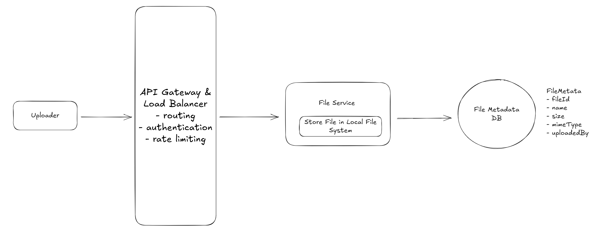
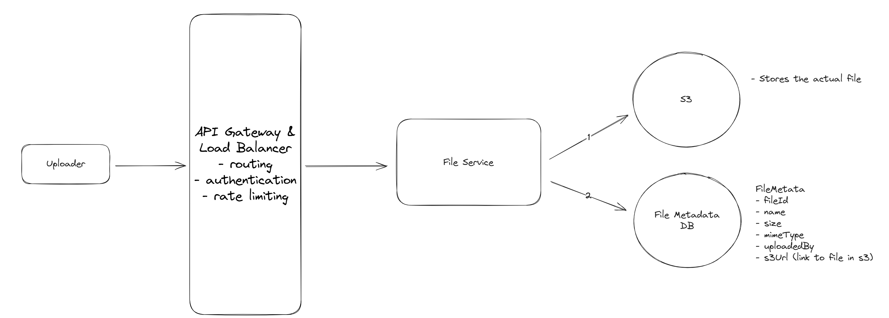
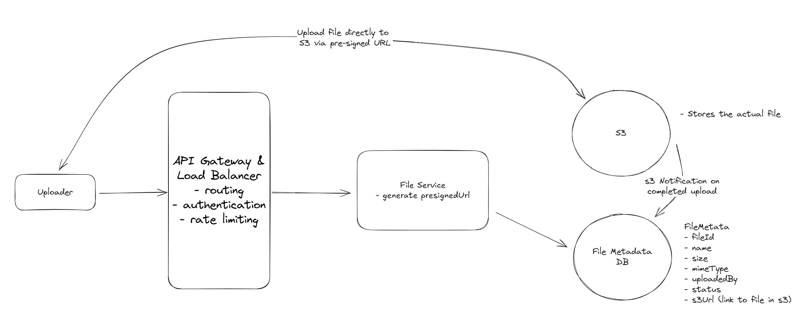
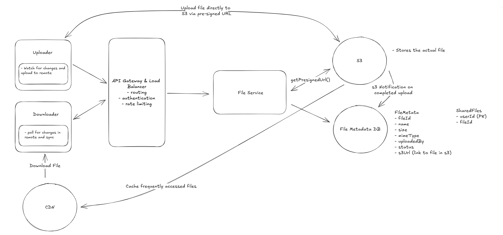

# [Dropbox](https://www.hellointerview.com/learn/system-design/problem-breakdowns/dropbox)
Dropbox is a cloud-based file storage service that allows users to store and share files. It provides a secure and reliable way to store and access files from anywhere, on any device.

## Functional Requirements
### Core Requirements
- Users should be able to upload a file from any device
- Users should be able to download a file from any device
- Users should be able to share a file with other users and view the files shared with them
- Users can automatically sync files across devices
- Users should be able to edit files (out of scope)
- Users should be able to view files without downloading them (out of scope)
> It's worth noting that there are related system design problems around designing Blob Storage itself. This is out of scope for this problem, but you may consider doing some research on your own to understand how Blob Storage works and how it's designed.


## Non-Functional Requirements
### Core Requirements
- The system should be highly available (prioritizing availability over consistency).
- The system should support files as large as 50GB.
- The system should be secure and reliable. We should be able to recover files if they are lost or corrupted.
- The system should make upload, download, and sync times as fast as possible (low latency).
- The system should have a storage limit per user
- The system should support file versioning
- The system should scan files for viruses and malware


> Many candidates struggle with the CAP theorem trade-off for this question. Remember, you prioritize consistency over availability only if every read must receive the most recent write; otherwise, the system will break. For example, with a stock trading app, if a user buys a share of AAPL in Germany and then another user immediately tries to buy a share of AAPL in the US, you need to be sure that the first transaction has been replicated to the US before you can proceed. However, for a file storage system like Dropbox, it's okay if a user in Germany uploads a file and a user in the US can't see it for a few seconds.

---

## Planning the Approach

## Defining the Core Entities
I like to start with a broad overview of the primary entities. At this stage, it is not necessary to know every specific column or detail. We will focus on these intricacies later when we have a clearer grasp of the system (during the high-level design). Initially, establishing these key entities will guide our thought process and lay a solid foundation as we progress towards defining the API.

For Dropbox, the primary entities are incredibly straightforward:
- **File:** This is the raw data that users will be uploading, downloading, and sharing.
- **FileMetadata:** This is the metadata associated with the file. It will include information like the file's name, size, mime type, and the user who uploaded it.
- **User:** The user of our system.

> As you move onto the design, your objective is simple: create a system that meets all functional and non-functional requirements. To do this, I recommend you start by satisfying the functional requirements and then layer in the non-functional requirements afterward. This will help you stay focused and ensure you don't get lost in the weeds as you go.


## API or System Interface
```text
POST /files
{
  File, 
  FileMetadata
}
```
To download a file, our endpoint can be:
```text
GET /files/{fileId} -> File & FileMetadata
```

To share a file, we might have an endpoint like this:
```text
POST /files/{fileId}/share
{
  User[] // The users to share the file with
}
```

Lastly, we need a way for clients to query for changes to files on the remote server. This way we know which files need to be synced to the local device.
```text
GET /files/changes?since={timestamp} -> ChangeEvent[]
```

> Don't use a userId from the request body or headers to identify who's making the request; the client can forge either. Validate the session token or JWT instead, use it to identify the current user, and check that user's access to the requested file.


---


## High-Level Design
### 1) Users should be able to upload a file from any device
The main requirement for a system like Dropbox is to allow users to upload files. When it comes to storing a file, we need to consider two things:
1. Where do we store the file contents (the raw bytes)?
2. Where do we store the file metadata?

For the metadata, we can use a `NoSQL` database like `DynamoDB`. 

Our schema will be a simple document and can start with something like this:
```text
{
    "id": "123",
    "name": "file.txt",
    "size": 1000,
    "mimeType": "text/plain",
    "uploadedBy": "user1"
  }
```

As for how we store the file itself, we have a few options. Let's take a look at the trade-offs of each.

### Bad Solution: Upload File to a Single server
The simplest approach we can take is to upload files directly to our backend server (we can call it the File Service) and store them there. Our POST /files endpoint will accept the file and metadata, and then store the file on the server's local file system while saving the metadata in our database. This is a reasonable approach for a small application, but it won't scale well and is not reliable.




### Challenges
This simple approach has a number of issues. As the number of files grows, we will need to add more and more storage to our server and/or horizontally scale by adding more servers. Second, it's not reliable. If our server goes down, we lose access to all of our files. We need a more reliable solution that can handle server failures and scale with ease. Fortunately, this is a solved problem. We can use Blob Storage to solve both of these issues.

## Good Solution: Store file in [Blob Storage]()
A better approach is to store the file in a Blob Storage service like Amazon S3 or Google Cloud Storage. When a user uploads a file to our backend, we can send the file directly to Blob Storage and store the metadata in our database. We can store a (virtually) unlimited number of files in Blob Storage as it will handle the scaling for us. It's also more reliable. If our server goes down, we don't lose access to our files. We can also take advantage of Blob Storage features like lifecycle policies to automatically delete old files and versioning to keep track of file changes if needed (though this is out of scope for this problem).



### Challenges
One challenge with this approach is that it's more complex. We need to integrate with the Blob Storage service and handle the case where the file is uploaded but the metadata is not saved. We also need to handle the case where the metadata is saved but the file is not uploaded. We can solve these issues by using a transactional approach where we only save the metadata if the file is successfully uploaded and vice versa.
Second, this approach (as depicted above) requires that we technically upload a file twice -- once to our backend and once to Blob Storage. This is redundant. We can solve this issue by allowing the user to upload the file directly to the Blob Storage service.


## Great Solution: Upload File Directly to Blob Storage
The best approach is to allow the user to upload the file directly to Blob Storage from the client. This is faster and cheaper than uploading the file to our backend first. We can use presigned URLs to generate a URL that the user can use to upload the file directly to the Blob Storage service. Once the file is uploaded, the Blob Storage service will send a notification to our backend so we can save the metadata.

Presigned URLs are URLs that give the user permission to upload a file to a specific location in the Blob Storage service. We can generate a presigned URL and send it to the user when they want to upload a file. So whereas our initial API for upload was a POST to /files, it will now be a three step process:

1. Request a pre-signed URL from our backend (which generates the URL using the S3 SDK) and save the file metadata in our database with a status of "uploading."
    ```text
    POST /files/presigned-url -> PresignedUrl
    {
      FileMetadata
    }
    ```
2. Use the presigned URL to upload the file to Blob Storage directly from the client. This is via a PUT request directly to the presigned URL where the file is the body of the request.
3. Once the file is uploaded, the Blob Storage service will send a notification to our backend using S3 Notifications. Our backend will then update the file metadata in our database with a status of "uploaded".



---

## Pattern: Handling Large Blobs
The direct upload approach using presigned URLs is a classic example of handling large file transfers efficiently. This pattern of bypassing application servers for data transfer, using signed URLs for security, and implementing chunked uploads for reliability appears across many distributed systems that handle substantial file uploads and downloads.

---

## 2. Users should be able to download a file from any device
The next step is making sure users can download their saved files. Just like with uploads, there are a few different ways to approach this.


### Bad Solution: Download through File Server
### Good Solution: Download from Blob Storage

### Great Solution: Download from CDN


---


## 3) Users should be able to share a file with other users

### Bad Solution: Add a Sharelist to metadata
A good start is to simply add a list of users who have access to the file directly to the file metadata. When a user shares a file, we can add the user to the list. When a user downloads a file, we can check if they are in the list. This is a simple and effective approach.

```text
{
  "id": "123",
  "name": "file.txt",
  "size": 1000,
  "mimeType": "text/plain",
  "uploadedBy": "user1",
  "sharelist": ["user2", "user3"]
}
```

### Challenges
When a user opens our site they expect to see a list of all of their files and files that have been shared with them. Getting the list of their files is easy - we can query using an index on uploadedBy. But getting the list of files shared with them is slow with this approach. We would need to scan the sharelist of every file to see if the user is in it.


### Good Solution: caching to speed up the Sharelist
A better approach is, in addition to the sharelist in the file metadata, to cache a list that maps the inverse relationship. This would be a mapping from any given user to the list of files shared with them. This way, when a user opens our site, we can quickly get the list of files shared with them by looking up their userId in our sharedFiles cache.

Our cache entry would be a simple key-value pair like this:
```text
user1:["fileId1", "fileId2"]
```

### Challenges
We need to keep the sharedFiles list in sync with the sharelist in the file metadata. The best way to overcome this would be to just keep this user to file list mapping in the same database and update both the sharelist and sharedFiles list in a transaction.


## Great Solution: Create a separate table for shares
```text
| userId (Partition Key) | fileId (Sort Key) |
|-------------|-------------|
| user1       | fileId1     |
| user1       | fileId2     |
| user2       | fileId3     |
```


---

## 4. Users can automatically sync files across devices
Last up, we need to make sure that files are automatically synced across different devices. At a high level, this works by keeping a copy of a particular file on each client device (locally) and also in remote storage (i.e., the "cloud"). As such, there are two directions we need to sync in:
- Local -> Remote
- Remote -> Local


### Local -> Remote
When a user updates a file on their local machine, we need to sync these changes with the remote server. We consider the remote server to be the source of truth, so it's important that we get it consistent as soon as possible so that other local devices can know when there are changes they should pull in.

To do this, we need a client-side sync agent that:
- Monitors the local Dropbox folder for changes using OS-specific file system events (like FileSystemWatcher on Windows or FSEvents on macOS)
- When it detects a change, it queues the modified file for upload locally
- It then uses our upload API to send the changes to the server along with updated metadata
- Conflicts are resolved using a "last write wins" strategy - meaning if two users edit the same file, the most recent edit will be the one that's saved

> Versioning is out of scope for this write-up, but note that you would typically not overwrite the only file. Instead, you'd add a new file (or at least the new chunks) and update a version number and pointer on the metadata.


### Remote -> Local
1. **Polling**
2. **WebSocket or SSE**

For Dropbox, we can use a hybrid approach. Each client maintains a single WebSocket (or SSE) connection to the server, not one per file, but one per device/session. Through this connection, the server pushes change notifications for files the user has access to. The hybrid part comes in with how we handle reliability:
- **Active notification:** The server pushes change events through the WebSocket connection in real-time as they happen. This gives us near-instant sync for any file change.
- **Periodic polling as a safety net:** WebSocket connections can drop, and messages can be missed. To handle this, the client also periodically polls the server (e.g., every few minutes) using GET /files/changes?since={timestamp} to catch any changes it might have missed. This ensures eventual





## Potential Deep Dives
### 1. How can you support large files?
- Progress Indicator:
- Resumable Uploads:
- **Timeouts:** Web servers and clients typically have timeout settings to prevent indefinite waiting for a response. A single POST request for a 50GB file could easily exceed these timeouts. In fact, this may be an appropriate time to do some quick math in the interview. If we have a 50GB file and an internet connection of 100Mbps, how long will it take to upload the file? `50GB * 8 bits/byte / 100Mbps = 4000 seconds` then `4000 seconds / 60 seconds/minute / 60 minutes/hour = 1.11 hours.` That's a long time to wait without any response from the server.
- **Browser and Server Limitation:** In most cases, it's not even possible to upload a 50GB file via a single POST request due to limitations configured in the browser or on the server. Both browsers and web servers often impose limits on the size of a request payload. While raw web servers like Apache and NGINX can be configured to accept large payloads, most modern services like Amazon API Gateway have hard limits that are much lower and cannot be increased. This is just 10MB in the case of Amazon API Gateway which we are using in our design.
- **Network Interruptions:** Large files are more susceptible to network interruptions. If a user is uploading a 50GB file and their internet connection drops, they will have to start the upload from scratch.
- **User Experience:** Users are effectively blind to the progress of their upload. They have no idea how long it will take or if it's even working.


To address these limitations, we can use a technique called "**chunking**" to break the file into smaller pieces and upload them one at a time (or in parallel, depending on network bandwidth). Chunking needs to be done on the client so that the file can be broken into pieces before it is sent to the server (or S3 in our case). A very common mistake candidates make is to chunk the file on the server, which effectively defeats the purpose since you still upload the entire file at once to get it on the server in the first place. When we chunk, we typically break the file into 5-10 MB pieces, but this can be adjusted based on the network conditions and the size of the file.

With chunks, it's rather straightforward for us to show a progress indicator to the user. We can simply track the progress of each chunk and update the progress bar as each chunk is successfully uploaded. This provides a much better user experience than the user simply staring at a spinning wheel for an hour.


The next question is: how will we handle **resumable uploads**? We need to keep track of which chunks have been uploaded and which haven't. We can do this by saving the state of the upload in the database, specifically in our FileMetadata table. Let's update the FileMetadata schema to include a chunks field.


```text
{
  "id": "123",
  "name": "file.txt",
  "size": 1000,
  "mimeType": "text/plain",
  "uploadedBy": "user1",
  "status": "uploading",
  "chunks": [
    {
      "id": "chunk1",
      "status": "uploaded"
    },
    {
      "id": "chunk2",
      "status": "uploading"
    },
    {
      "id": "chunk3",
      "status": "not-uploaded"
    }
  ]
}
```

## 2. How can you ensure file security?
- Encryption in Transit
- Encryption at Rest
- Access Control