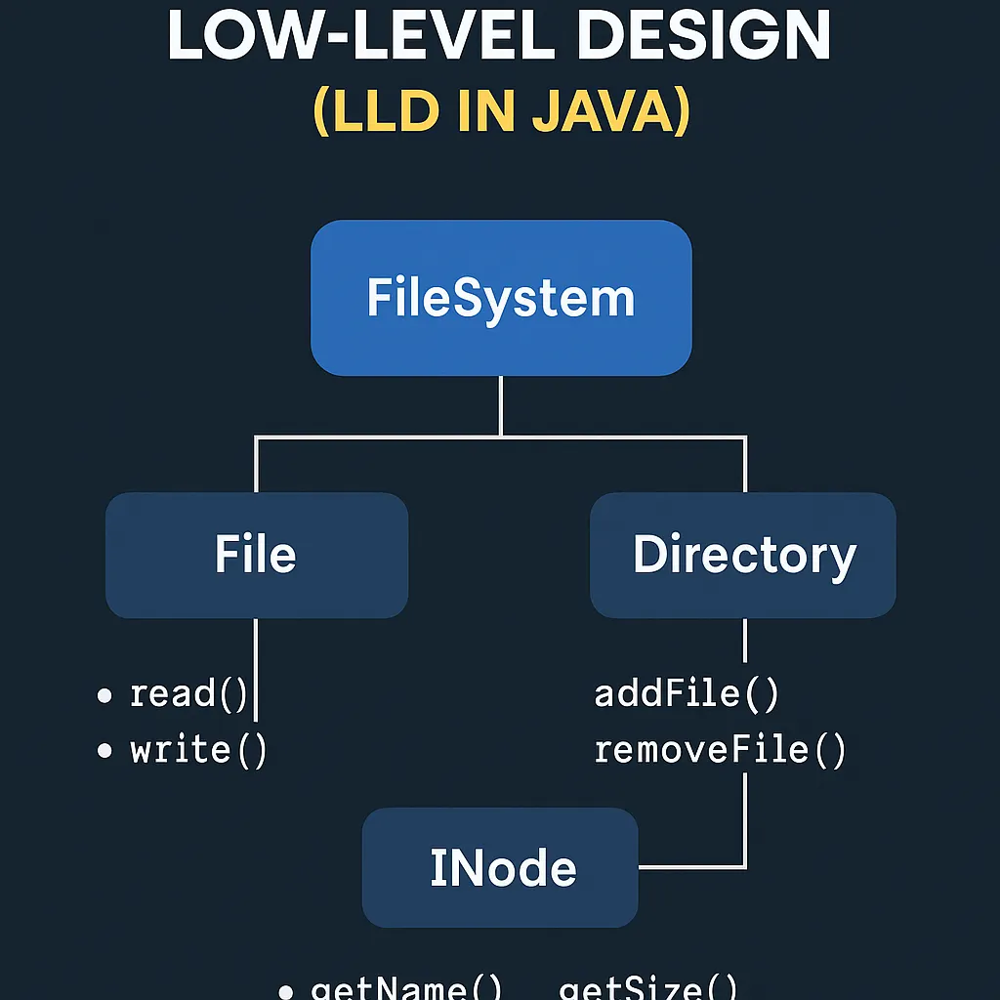
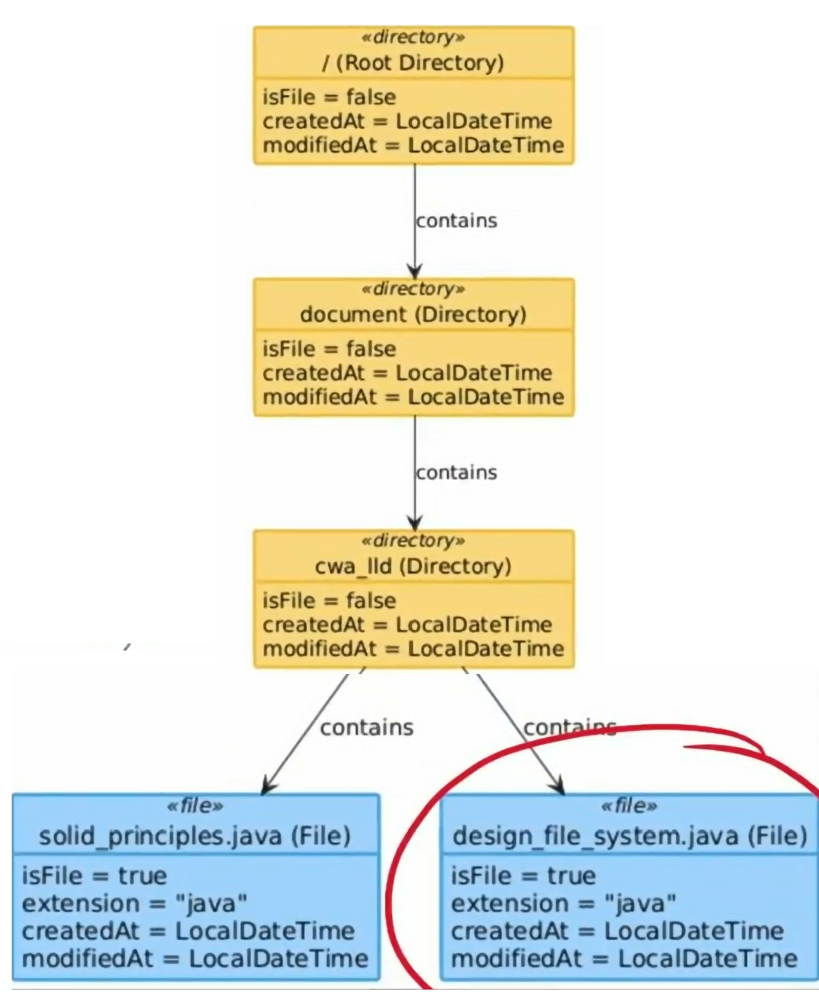
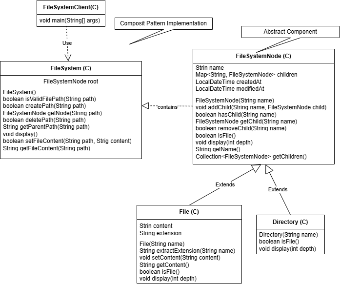

# [Design a File System](https://algo.monster/liteproblems/1166) 
- [link](https://medium.com/@ankitviddya/designing-a-file-system-low-level-design-lld-in-java-c51812c79fd2)




- You need to design a file system that can create new file paths and associate integer values with them.
- Support hierarchical path structure: using the "/" delimiter
- Implement path creation and value association
- Manage file metadata
- Handle different file types
- CRUD operations


A valid path follows these rules:
- It starts with / followed by one or more lowercase English letters
- Multiple directories can be concatenated with / as separator
- Examples of valid paths: `/leetcode`, `/leetcode/problems`
- Invalid paths: empty string `""`, just `/`

Your FileSystem class should implement two methods:
- createPath(path, value):
  - Creates a new path and associates it with the given integer value
  - Returns **true** if the path was successfully created
  - Returns **false** if:
    - The path already exists, OR
    - The parent path doesn't exist (e.g., trying to create `/a/b/c` when `/a/b` doesn't exist)
- get(path):
  - Returns the integer value associated with the given path
  - Returns `-1` if the path doesn't exist


## Solution:
uses a [Trie]() (prefix tree) data structure where:


## Intuition
When we think about file systems, they naturally form a tree-like hierarchy. Each directory can contain multiple subdirectories, and we navigate through them level by level using path separators (`/`). This hierarchical structure immediately suggests using a tree data structure.

The key insight is that we need to efficiently:
- Check if parent paths exist when creating a new path
- Navigate through the path components to store or retrieve values

A [Trie]() (prefix tree) is perfect for this because:
- File paths share common prefixes (e.g., /leetcode and /leetcode/problems share /leetcode)
- We can traverse the trie level by level, matching each path segment
- Checking parent existence becomes natural - we just verify each node exists as we traverse


For the **createPath** operation, we can split the path by `/` and traverse the trie until we reach the parent of the target node. If any intermediate node doesn't exist, the parent path is missing, so we return false. If we successfully reach the parent and the target doesn't already exist, we create it.


For the get operation, we simply traverse the trie following the path segments. If we can reach the target node, we return its value; otherwise, we return -1.


### 1. Trie Node Structure (`FileSystemnode` / `TrieNode`)
```text
class 
```

### 2. File class
- represent individual files
- Store file-specific metadata and content

### 3. Directory class
- Manages collection of files and subdirectories
- Support Hierarchical organization

### 4. FileSystemManager
- Central manager for file system operations
- Handles path creation, validation, and retrieval





---




```java
public abstract class FileSystemNode {
  private Strin name;
  private Map<String, FileSystemNode> children;
  private LocalDateTime createdAt;
  private LocalDateTime modifiedAt;

  public FileSystemNode(String name) {
    this.name = name;
    this.children = new HashMap<>();
    this.createdAt = LocalDateTime.now();
    this.modifiedAt = LocalDateTime.now();
  }

  public void addChild(String name, FileSystemNode child) {this.children.put(name, child);}
  boolean hasChild(String name) { return this.children.containsKey(name);}
  public FileSystemNode getChild(String name) { return this.children.get(name); }
  boolean removeChild(String name) { return children.remove(name) != null;}
  public String getName() { return name; }
  public Collection<FileSystemNode> getChildren() { return children.values(); }
  public LocalDateTime getCreatedAt() { return this.createdAt; }
  public LocalDateTime getModifiedAt() { return this.modifiedAt; }

  // Abstract methods for node operations
  public abstract boolean isFile();
  public abstract void display(int depth);
}
```

```java
public class File extends FileSystemNode {
    private String content;
    private String extension;
    
    public File(String name) {
        super(name);
        this.extension = extractExtension(name);
    }
    
    public void setContent(String content) { 
        this.content = content;
        updateModifiedTime();
    }
    
    @Override
    public boolean isFile() { return true; }
  
    @Override
    public void display(int depth) {
        // Example: for a file at path "/docs/lld/note.txt" at depth 3
        // indent = "      " (6 spaces : depth 3 * 2 spaces per depth)
        // Output should be "      "📄note.text
      
        String indent = " ".repeat(depth * 2);
        System.out.println(indent + "📄 " + getName());
    }
    
    private String extractExtension(String name) {
        int dotIndex = name.lastIndexOf('.');
        return (dotIndex > 0) ? name.substring(dotIndex + 1) : "";
    }
}
```

```java
public class Directory extends FileSystemNode {    
    public File(String name) {
        super(name);
    }
    
    @Override
    public boolean isFile() { return false; }
  
    @Override
    public void display(int depth) {
        // Example: for a directory at path "/docs/lld" at depth 2
        // indent = "    " (4 spaces : depth 2 * 2 spaces per depth)
        // Lets say it has 3 child items
        // Output should be "      "📁 lld (3 items)
        // Then it will recursively display each child with depth 3 
      
        String indent = " ".repeat(depth * 2);
        System.out.println(indent + "📁 " + getName() + " (" + getChildren().size() + " items)");
        
        // Then for each child we recursively call display()
        for (FileSystemNode child : getChildren()) {
            child.display(depth+1);
        }
    }
    
    private String extractExtension(String name) {
        int dotIndex = name.lastIndexOf('.');
        return (dotIndex > 0) ? name.substring(dotIndex + 1) : "";
    }
}
```

```java
public class FileSystem {
    private FileSystemNode root;
    
    public FileSystem() {
        this.root = new Directory("/");
    }
    
    public boolean isValidPath(String path) {
        return path != null && !path.isEmpty() && !path.startsWith("/");
    }
    
    //  Create a new path: "/docs/lldnote.txt"
    public boolean createPath(String path) {
        // validate path
        if (!isValidPath(path)) return false;
        
        // split path into components
        String[] pathComponents = path.split("/");
      
        // start from root, current = root directory "/"
        FileSystemNode current = root;
        
        // traverse to the parent directory
        // We need to process: "docs" and "lld" (stopping before the last component)
        for(int i=1; i < pathComponents.length - 1; i++) {
            String component = pathComponents[i];
            if (component.isEmpty()) continue; // skip empty components
          
            // First iteration:  component = "docs"
            // Second iteration: component = "lld"
            
            if (!current.hasChild(component)) {
                FileSystemNode newDir = new Directory(component);
                current.addChild(component, newDir);
            }

            FileSystemNode child = current.getChild(component);
            if (child.isFile()) {
                return false;
            }
            
            // Move to the next level
            current = child;
        }
        
        // Get the last component (file or directory name)
        String lastComponent = pathComponents[pathComponents.length - 1];
        if (lastComponent.isEmpty()) return false;
        
        // Check if the new component already exists
        // if "note.txt" is already exists under "lld", return false
        if (current.hasChild(lastComponent)) {
            return false;
        }
        
        // Create new node based on whether it's a file (has extension) or directory
        // "lld" has no dot, so create as directory
        FileSysmNode newNode;
        if (lastComponent.contains(".")) {
            newNode = new File(lastComponent);
        } else {
            newNode = new Directory(lastComponent);
        }
        
        // Add the new node to the parent
        current.addChild(lastComponent, newNode);
        return true;        
    }
    
    private FileSystemNode getNode(String path) {
      // validate path
      if (!isValidPath(path)) return null;
      
      // For root path
      if (path.equals("/")) return root;
      
      String[] pathComponents = path.split("/");
      
      // Start from root
      FileSystemNode current = root;
      for (int i=1; i<pathComponents.length; i++) {
          String component = pathComponents[i];
          if (component.isEmpty()) continue; // skip empty components

          // First iteration:  component = "docs"
          // Second iteration: component = "lld"
  
          if (!current.hasChild(component)) {
              return null;
          }
  
          current = current.getChild(component);
      }
      return current;
    }
    
    public boolean deletePath(String path) {
        if (!isValidPath(path)) return false;
        if (path.equals("/")) return false; // Cant delete root
        
        String parentPath = getParentPath(path);
        FileSystemNode parent = getNode(parentPath);
        
        // If parent not exist or is a File, cont delete
        // Assuming parent exist and is a directory, continue
        if (parent == null || parent.isFile()) return false;
        
        // 
        String lastComponent = path.substring(path.lastIndexOf('/') + 1);
        if (!parent.hasChild(lastComponent)) {
            return false;
        }
        
        return parent.removeChild(lastComponent);
    }
    
    private String getParentPath(String path) {
        int lastSlash = path.lastIndexOf('/');
        if (lastSlash <= 0) return "/";
        return path.substring(0, lastSlash);
    }
    
    public void display() {
        root.display(0);
    }
    
    public boolean setFileContent(String path, String content) {
        FileSystemNode node = getNode(path);
        if (node == null || !node.isFIle()) return false;
        
        File file = (File) node;
        file.setContent(content);
        return true;
    }
    
    public String getContentFromFile(String path) {
        FileSystemNode node = getNode(path);
        if (node == null || !node.isFIle()) return false;
        
        File file = (File) node;
        return file.getContent();        
    }
}
```

```java
public class FileSystemClient {
  public static void main(String[] args) {
    FileSystem fs = new FileSystem();

    // Create a scanner to handle user input
    Scanner sc = new Scanner(System.in);
    boolean isRunning = true;
    
    // Display instructions for the user
    System.out.println("======================================");
    System.out.println("       FILE SYSTEM MANAGER");
    System.out.println("======================================");
    System.out.println("Available Commands:");
    System.out.println("--------------------------------------");
    System.out.println("1. create <path>          - Create a new path");
    System.out.println("2. write <path> <content> - Write content to a file");
    System.out.println("3. read <path>            - Read content from a file");
    System.out.println("4. delete <path>          - Delete a path");
    System.out.println("5. display                - Display file system structure");
    System.out.println("6. exit                   - Exit the program");
    System.out.println("--------------------------------------");
    
    while (isRunning) {
        System.out.println("\nEnter command");
        String input = sc.nextLine().trim();
        String[] parts = input.split("\\s+", 3); // Split input into command, path, and possibly content
        
        if (parts.length == 0) continue;
        String command = parts[0].toLowerCase();
        
        try {
            switch (command) {
              case "create":
                  if (parts.length >= 2) {
                      String path = parts[1];
                      boolean isCreated = fs.createPath(path);
                      System.out.println(isCreated ? "Path created successfully" : "Failed to create path");
                  } else {
                      System.out.println("Usage: create <path>");
                  }
                  break;
              case "write":
                  if (parts.length >= 3) {
                      String path = parts[1];
                      String content = parts[2];
                      boolean isWritten = fs.setFileContent(path, content);
                      System.out.println(isWritten ? "Content written successfully" : "Failed to write content");
                  } else {
                      System.out.println("Usage: write <path> <content>");
                  }
                  break;
              case "read":
                  if (parts.length >= 2) {
                      String path = parts[1];
                      String content = fs.getFileContent(path);
                      System.out.println(content != null ? "Content: "+ content :"Failed to read content");                      
                  } else {
                      System.out.println("Usage: read <path>");
                  }
                  break;
              case "delete":
                  if (parts.length >= 2) {
                      String path = parts[1];
                      boolean isDeleted = fs.deletePath(path);
                      System.out.println(isDeleted ? "Path deleted successfully" : "Failed to delete path");
                  } else {
                      System.out.println("Usage: delete <path>");
                  }
                  break;
              case "display":
                  System.out.println("\n File System Structure:");
                  System.out.println("--------------------------------------");
                  fs.display();
                  System.out.println("--------------------------------------");
                  break;
              case "exit":
                  isRunning = false;
                  System.out.println("Exiting...");
                  break;
              default:
                  System.out.println("Unknown command. Available commands: write, read, delete, display, exit");
            }
        } catch (Exception e) {
            System.out.println("Error: " + e.getMessage());
        }          
    }
    sc.close();
  }
} 
```
Implemented **Composite Pattern** where both `File` and `Directory` shared a common interface


