# Design an In-Memory File System (LLD) — From Trie to Real Storage

> Based on [LeetCode 1166 — Design File System](https://algo.monster/liteproblems/1166), extended into a full low-level design with files, directories, metadata and CRUD operations, and then connected to how real file systems (ext4, XFS, NTFS, …) store data on disk.

```text
                         ┌──────────────────────┐
                         │      FileSystem      │
                         └──────────┬───────────┘
                                    │
                    ┌───────────────┴───────────────┐
                    │                               │
          ┌─────────▼─────────┐           ┌─────────▼─────────┐
          │       File        │           │     Directory     │
          └─────────┬─────────┘           └─────────┬─────────┘
                    │                               │
              ┌─────┴─────┐                   ┌─────┴─────────┐
              │           │                   │               │
           read()      write()             addFile()      removeFile()
                                                    │
                                                    │
                                          ┌─────────▼─────────┐
                                          │       INode       │
                                          └─────────┬─────────┘
                                                    │
                                             ┌──────┴──────┐
                                             │             │
                                         getName()     getSize()
```

---

## Table of Contents

1. [Problem Statement](#1-problem-statement)
2. [Intuition — Why a Trie?](#2-intuition--why-a-trie)
3. [Solution A — LeetCode Version (Trie + Integer Values)](#3-solution-a--leetcode-version-trie--integer-values)
4. [Solution B — Extended LLD (Composite Pattern)](#4-solution-b--extended-lld-composite-pattern)
5. [Walkthrough of Each Operation](#5-walkthrough-of-each-operation)
6. [Complexity Analysis](#6-complexity-analysis)
7. [What Was Corrected From the Original Draft](#7-what-was-corrected-from-the-original-draft)
8. [Future Improvement — Backing the Design With a Real Storage Device](#8-future-improvement--backing-the-design-with-a-real-storage-device)
9. [How a Real File System Works](#9-how-a-real-file-system-works)
10. [Comparing Real File Systems](#10-comparing-real-file-systems)
11. [Why Do So Many File Systems Exist?](#11-why-do-so-many-file-systems-exist)
12. [Summary](#12-summary)


```text
                                ┌──────────────────────┐
                                │   FileSystemClient   │
                                └──────────┬───────────┘
                                           │ uses
                                ┌──────────▼───────────┐
                                │      FileSystem      │
                                │ root: Directory("/") │
                                └──────────┬───────────┘
                                           │
         ┌──────────────┬──────────────────┼──────────────────┬──────────────┐
         │              │                  │                  │              │
    createPath()   deletePath()            │          setFileContent()  getFileContent()
                                           │ manages
                                ┌──────────▼───────────┐
                                │    FileSystemNode    │
                                │     «abstract»       │
                                │ name, createdAt,     │
                                │ modifiedAt           │
                                └──────────┬───────────┘
                                           │
                               ┌───────────┼───────────┐
                               │           │           │
                           getName()       │       display()
                                           │        isFile()
                         ┌─────────────────┴─────────────────┐
                         │ extends                   extends │
               ┌─────────▼─────────┐               ┌─────────▼─────────┐
               │       File        │               │     Directory     │
               │      (Leaf)       │               │    (Composite)    │
               │ content,extension │               │ children: Map     │
               └─────────┬─────────┘               └─────────┬─────────┘
                         │                                   │
               ┌─────────┴─────────┐           ┌─────────────┼─────────────┐
               │                   │           │             │             │
          getContent()       setContent()  addChild()        │        removeChild()
                                           getChild()        │
                                                             │ contains 0..*
                                                   ┌─────────▼─────────┐
                                                   │  FileSystemNode   │
                                                   │ (File | Directory)│
                                                   └───────────────────┘
```

```text
                  +---------------------------+
                  |     FileSystemClient(C)   |
                  +---------------------------+
                  |                           |
                  | void main(String[] args)  |
                  +---------------------------+
                              |
                              | Use
                              v
+----------------------------------+       +--------------------------------------+
|          FileSystem (C)          |       |       FileSystemNode (C)             |
+----------------------------------+       +--------------------------------------+
| FileSystemNode root              |       | String name                         |
+----------------------------------+       | Map<String, FileSystemNode> children|
| FileSystem()                     |       | LocalDateTime createdAt              |
| boolean isValidFilePath(String)  |       | LocalDateTime modifiedAt             |
| boolean createPath(String)       |       +--------------------------------------+
| FileSystemNode getNode(String)   | <---- | FileSystemNode(String name)          |
| boolean deletePath(String)       |       | void addChild(String, FileSystemNode)|
| String getParentPath(String)     |       | boolean hasChild(String)             |
| void display()                   |       | FileSystemNode getChild(String)      |
| boolean setFileContent(String,   |       | boolean removeChild(String)          |
|                   String)        |       | boolean isFile()                     |
| String getFileContent(String)    |       | void display(int depth)              |
+----------------------------------+       | String getName()                     |
                                           | Collection<FileSystemNode>           |
                                           |     getChildren()                    |
                                           +--------------------------------------+
                                                         ^
                                                        / \
                                                       /   \
                                                  Extends   Extends
                                                     /       \
                                                    /         \
                          +----------------------+             +----------------------+
                          |       File (C)       |             |    Directory (C)     |
                          +----------------------+             +----------------------+
                          | String content       |             |                      |
                          | String extension     |             +----------------------+
                          +----------------------+             | Directory(String name)|
                          | File(String name)    |             | boolean isFile()      |
                          | String extractExten- |             | void display(int depth)|
                          |       sion(String)   |             +----------------------+
                          | void setContent(String)|
                          | String getContent()  |
                          | boolean isFile()     |
                          | void display(int depth)|
                          +----------------------+
```

---

## 1. Problem Statement

Design a file system that can create new paths and associate data with them.

### Requirements
- **File Operations:** CRUD, Track size and timestamps
- Support text/binary types
- **Permission Management:** Read (r), Write (w), Execute (x) Applied on both files & directories
- **Error Handling:** Invalid permissions, File not found, Duplicate name, Directory not found
- **Scalability:** 
  - Very large directory trees
  - Efficient search & traversal
  - Extendable for symbolic links, versioning, caching

### Core requirements (LeetCode 1166)

| Method | Behaviour |
|---|---|
| `createPath(path, value)` | Creates a new path and associates `value` with it. Returns **true** on success. Returns **false** if the path **already exists** or its **parent path does not exist** (e.g. creating `/a/b/c` when `/a/b` is missing). |
| `get(path)` | Returns the value associated with `path`, or **-1** if the path does not exist. |

### A valid path

- Starts with `/` followed by one or more lowercase English letters.
- Multiple names can be joined with `/` as separator.
- ✅ Valid: `/leetcode`, `/leetcode/problems`
- ❌ Invalid: `""` (empty string), `/` (root alone)

### Extended requirements (LLD interview version)

- Hierarchical path structure using `/` as delimiter
- Distinguish **files** and **directories**
- Store **metadata** (name, created time, modified time, extension)
- Full **CRUD**: create, read, write (update), delete
- Display the tree

---

## 2. Intuition — Why a Trie?

A file system is naturally a **tree**: every directory can contain many sub-directories and files, and we navigate it one level at a time using `/`.

```text
/
├── leetcode
│   └── problems
└── docs
    └── lld
        └── note.txt
```

We need to efficiently:

1. **Check that the parent exists** before creating a path.
2. **Walk the path segment by segment** to store or read a value.

A **Trie (prefix tree)** fits perfectly, where each node represents **one path segment** instead of one character:

- Paths share prefixes — `/leetcode` and `/leetcode/problems` both start with `leetcode`, so they share a node.
- Traversal is level-by-level: split the path on `/` and follow one child per segment.
- Parent-existence checking comes for free — if a node is missing while walking, the parent does not exist.

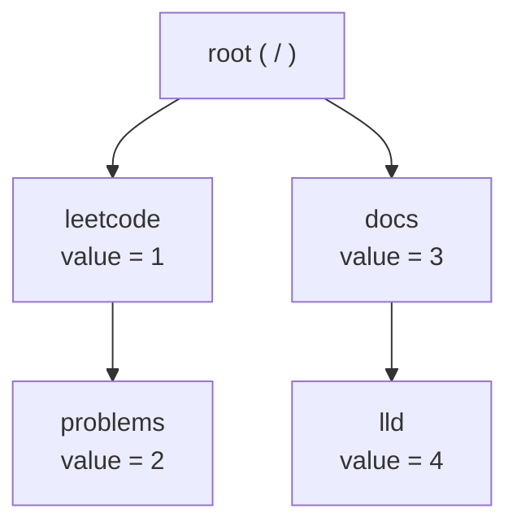

### Algorithm sketch

**`createPath(path, value)`**

1. Split the path by `/` → `["", "leetcode", "problems"]`.
2. Walk from the root through every segment **except the last**. If any segment is missing → return `false` (parent missing).
3. If the last segment already exists under the parent → return `false`.
4. Otherwise create the node, store the value, return `true`.

**`get(path)`**

1. Split the path and walk every segment.
2. If any segment is missing → return `-1`; otherwise return the node's value.

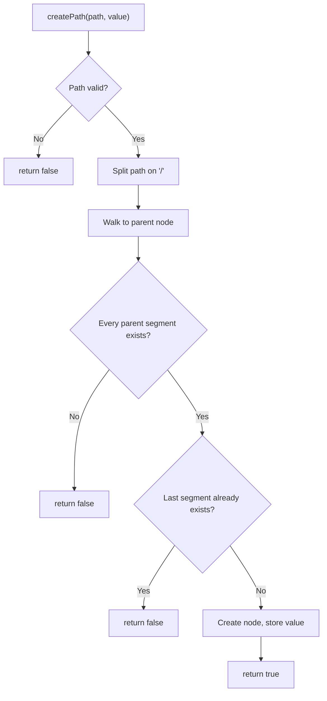

---

## 3. Solution A — LeetCode Version (Trie + Integer Values)

```java
import java.util.HashMap;
import java.util.Map;

class FileSystem {

    private static class TrieNode {
        final Map<String, TrieNode> children = new HashMap<>();
        int value = -1;
    }

    private final TrieNode root = new TrieNode();

    public boolean createPath(String path, int value) {
        if (path == null || path.isEmpty() || path.equals("/")) return false;

        String[] parts = path.split("/");            // "/a/b" -> ["", "a", "b"]
        TrieNode node = root;

        // Walk to the parent (skip index 0, which is "", and stop before the last part)
        for (int i = 1; i < parts.length - 1; i++) {
            node = node.children.get(parts[i]);
            if (node == null) return false;          // parent path does not exist
        }

        String last = parts[parts.length - 1];
        if (node.children.containsKey(last)) return false;  // path already exists

        TrieNode child = new TrieNode();
        child.value = value;
        node.children.put(last, child);
        return true;
    }

    public int get(String path) {
        if (path == null || path.isEmpty() || path.equals("/")) return -1;

        String[] parts = path.split("/");
        TrieNode node = root;
        for (int i = 1; i < parts.length; i++) {
            node = node.children.get(parts[i]);
            if (node == null) return -1;
        }
        return node.value;
    }
}
```

**Example**

```text
createPath("/leet", 1)       -> true
createPath("/leet/code", 2)  -> true
get("/leet/code")            -> 2
createPath("/c/d", 1)        -> false   (parent "/c" does not exist)
get("/c")                    -> -1
```

---

## 4. Solution B — Extended LLD (Composite Pattern)

For a real LLD interview we model **files** and **directories** separately, using the **Composite Pattern**:

- `FileSystemNode` — the abstract **Component** (common metadata + common operations).
- `File` — a **Leaf** (holds content, has no children).
- `Directory` — a **Composite** (holds children, which may be files or directories).
- `FileSystem` — the manager / facade that handles path validation, traversal and CRUD.
- `FileSystemClient` — a command-line client that uses the `FileSystem`.

Client code can call `display()` on any node without caring whether it is a file or a directory — that is the point of the Composite Pattern.

### 4.1 Class diagram

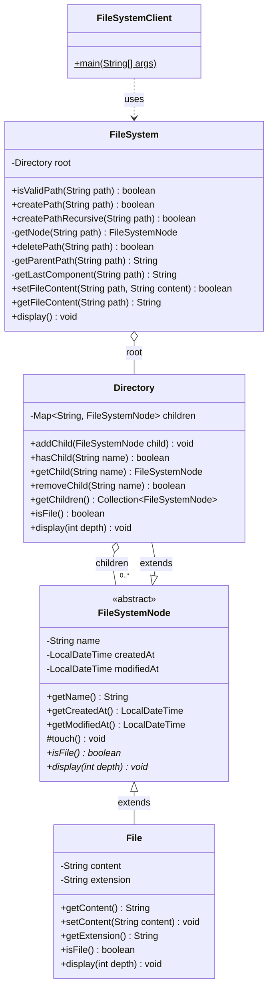

> **Design note:** the `children` map lives in `Directory`, not in the abstract `FileSystemNode`. A `File` can never have children, so putting the map in the base class would let callers do something meaningless like `file.addChild(...)`. This is the "safe" variant of the Composite Pattern.

### 4.2 Object tree at runtime

After creating `/docs`, `/docs/lld`, `/docs/lld/note.txt` and `/x/y/z.md`:

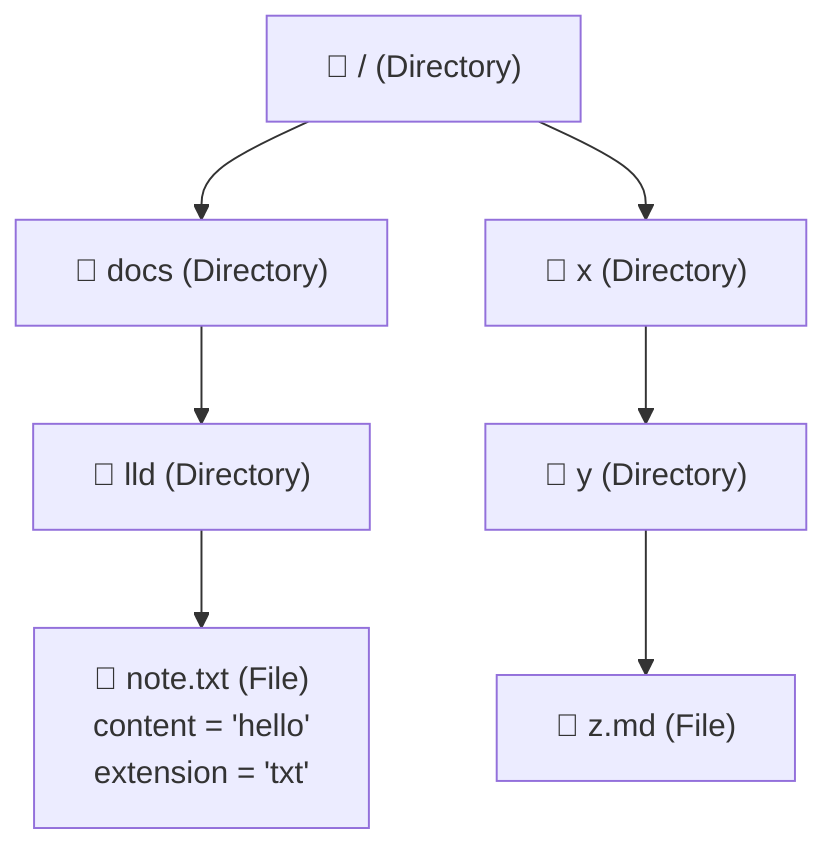

### 4.3 `FileSystemNode` — abstract component

```java
import java.time.LocalDateTime;

public abstract class FileSystemNode {
    private final String name;
    private final LocalDateTime createdAt;
    private LocalDateTime modifiedAt;

    protected FileSystemNode(String name) {
        this.name = name;
        this.createdAt = LocalDateTime.now();
        this.modifiedAt = this.createdAt;
    }

    public String getName() { return name; }
    public LocalDateTime getCreatedAt() { return createdAt; }
    public LocalDateTime getModifiedAt() { return modifiedAt; }

    /** Updates the modified timestamp; called by subclasses whenever they change. */
    protected void touch() { this.modifiedAt = LocalDateTime.now(); }

    // Operations every node must implement
    public abstract boolean isFile();
    public abstract void display(int depth);
}
```

### 4.4 `File` — leaf

```java
public class File extends FileSystemNode {
    private String content = "";
    private final String extension;

    public File(String name) {
        super(name);
        this.extension = extractExtension(name);
    }

    public String getContent() { return content; }
    public String getExtension() { return extension; }

    public void setContent(String content) {
        this.content = content;
        touch();
    }

    @Override
    public boolean isFile() { return true; }

    @Override
    public void display(int depth) {
        // e.g. "/docs/lld/note.txt" is at depth 3 -> 6 spaces of indent
        // Output: "      📄 note.txt"
        System.out.println(" ".repeat(depth * 2) + "📄 " + getName());
    }

    private static String extractExtension(String name) {
        int dot = name.lastIndexOf('.');
        return (dot > 0) ? name.substring(dot + 1) : "";   // ".bashrc" -> no extension
    }
}
```

### 4.5 `Directory` — composite

```java
import java.util.Collection;
import java.util.Map;
import java.util.TreeMap;

public class Directory extends FileSystemNode {
    // TreeMap keeps children sorted by name, so display() output is deterministic
    private final Map<String, FileSystemNode> children = new TreeMap<>();

    public Directory(String name) {
        super(name);
    }

    public boolean hasChild(String name) { return children.containsKey(name); }
    public FileSystemNode getChild(String name) { return children.get(name); }
    public Collection<FileSystemNode> getChildren() { return children.values(); }

    public void addChild(FileSystemNode child) {
        children.put(child.getName(), child);
        touch();
    }

    public boolean removeChild(String name) {
        boolean removed = children.remove(name) != null;
        if (removed) touch();
        return removed;
    }

    @Override
    public boolean isFile() { return false; }

    @Override
    public void display(int depth) {
        // e.g. "/docs/lld" is at depth 2 -> 4 spaces of indent
        // Output: "    📁 lld (1 items)", then each child at depth 3
        System.out.println(" ".repeat(depth * 2) + "📁 " + getName()
                + " (" + children.size() + " items)");

        for (FileSystemNode child : children.values()) {
            child.display(depth + 1);   // recursion — the heart of the Composite Pattern
        }
    }
}
```

### 4.6 `FileSystem` — manager / facade

```java
public class FileSystem {
    private final Directory root = new Directory("/");

    /**
     * Valid:   "/", "/docs", "/docs/lld/note.txt"
     * Invalid: null, "", "docs" (no leading slash), "/docs/" (trailing slash), "/a//b" (empty segment)
     */
    public boolean isValidPath(String path) {
        if (path == null || path.isEmpty() || !path.startsWith("/")) return false;
        if (path.equals("/")) return true;
        if (path.endsWith("/")) return false;
        for (String part : path.substring(1).split("/")) {
            if (part.isEmpty()) return false;
        }
        return true;
    }

    /** "/docs/lld" -> ["docs", "lld"];  "/" -> [] */
    private String[] split(String path) {
        return path.equals("/") ? new String[0] : path.substring(1).split("/");
    }

    /**
     * Creates ONLY the last component. The parent directory must already exist
     * (this matches the LeetCode rule). A name containing "." becomes a File,
     * anything else becomes a Directory.
     */
    public boolean createPath(String path) {
        if (!isValidPath(path) || path.equals("/")) return false;

        FileSystemNode parent = getNode(getParentPath(path));
        if (parent == null || parent.isFile()) return false;   // parent missing, or parent is a file

        Directory dir = (Directory) parent;
        String name = getLastComponent(path);
        if (dir.hasChild(name)) return false;                   // already exists

        FileSystemNode node = name.contains(".") ? new File(name) : new Directory(name);
        dir.addChild(node);
        return true;
    }

    /** Like "mkdir -p": creates any missing parent directories, then the last component. */
    public boolean createPathRecursive(String path) {
        if (!isValidPath(path) || path.equals("/")) return false;

        String[] parts = split(path);
        Directory current = root;
        for (int i = 0; i < parts.length - 1; i++) {
            FileSystemNode child = current.getChild(parts[i]);
            if (child == null) {
                child = new Directory(parts[i]);
                current.addChild(child);
            } else if (child.isFile()) {
                return false;                                   // can't go "through" a file
            }
            current = (Directory) child;
        }
        return createPath(path);
    }

    /** Walks the tree and returns the node at 'path', or null if it doesn't exist. */
    private FileSystemNode getNode(String path) {
        if (!isValidPath(path)) return null;

        FileSystemNode current = root;
        for (String part : split(path)) {
            if (current.isFile()) return null;                  // e.g. "/a.txt/b"
            current = ((Directory) current).getChild(part);
            if (current == null) return null;
        }
        return current;
    }

    public boolean deletePath(String path) {
        if (!isValidPath(path) || path.equals("/")) return false;   // can't delete root

        FileSystemNode parent = getNode(getParentPath(path));
        if (parent == null || parent.isFile()) return false;

        return ((Directory) parent).removeChild(getLastComponent(path));
    }

    private String getParentPath(String path) {
        int lastSlash = path.lastIndexOf('/');
        return (lastSlash <= 0) ? "/" : path.substring(0, lastSlash);
    }

    private String getLastComponent(String path) {
        return path.substring(path.lastIndexOf('/') + 1);
    }

    public boolean setFileContent(String path, String content) {
        FileSystemNode node = getNode(path);
        if (node == null || !node.isFile()) return false;
        ((File) node).setContent(content);
        return true;
    }

    public String getFileContent(String path) {
        FileSystemNode node = getNode(path);
        if (node == null || !node.isFile()) return null;
        return ((File) node).getContent();
    }

    public void display() {
        root.display(0);
    }
}
```

### 4.7 `FileSystemClient` — command-line driver

```java
import java.util.Scanner;

public class FileSystemClient {
    public static void main(String[] args) {
        FileSystem fs = new FileSystem();
        Scanner sc = new Scanner(System.in);
        boolean isRunning = true;

        System.out.println("======================================");
        System.out.println("          FILE SYSTEM MANAGER");
        System.out.println("======================================");
        System.out.println("Available Commands:");
        System.out.println("--------------------------------------");
        System.out.println("1. create <path>          - Create a new path (parent must exist)");
        System.out.println("2. mkdirp <path>          - Create a path and any missing parents");
        System.out.println("3. write <path> <content> - Write content to a file");
        System.out.println("4. read <path>            - Read content from a file");
        System.out.println("5. delete <path>          - Delete a path");
        System.out.println("6. display                - Display file system structure");
        System.out.println("7. exit                   - Exit the program");
        System.out.println("--------------------------------------");

        while (isRunning) {
            System.out.print("\nEnter command> ");
            if (!sc.hasNextLine()) break;
            String input = sc.nextLine().trim();
            if (input.isEmpty()) continue;

            // command, path, and (optionally) the rest of the line as content
            String[] parts = input.split("\\s+", 3);
            String command = parts[0].toLowerCase();

            try {
                switch (command) {
                    case "create" -> {
                        if (parts.length >= 2) {
                            boolean ok = fs.createPath(parts[1]);
                            System.out.println(ok ? "Path created successfully" : "Failed to create path");
                        } else System.out.println("Usage: create <path>");
                    }
                    case "mkdirp" -> {
                        if (parts.length >= 2) {
                            boolean ok = fs.createPathRecursive(parts[1]);
                            System.out.println(ok ? "Path created successfully" : "Failed to create path");
                        } else System.out.println("Usage: mkdirp <path>");
                    }
                    case "write" -> {
                        if (parts.length >= 3) {
                            boolean ok = fs.setFileContent(parts[1], parts[2]);
                            System.out.println(ok ? "Content written successfully" : "Failed to write content");
                        } else System.out.println("Usage: write <path> <content>");
                    }
                    case "read" -> {
                        if (parts.length >= 2) {
                            String content = fs.getFileContent(parts[1]);
                            System.out.println(content != null ? "Content: " + content : "Failed to read content");
                        } else System.out.println("Usage: read <path>");
                    }
                    case "delete" -> {
                        if (parts.length >= 2) {
                            boolean ok = fs.deletePath(parts[1]);
                            System.out.println(ok ? "Path deleted successfully" : "Failed to delete path");
                        } else System.out.println("Usage: delete <path>");
                    }
                    case "display" -> {
                        System.out.println("\nFile System Structure:");
                        System.out.println("--------------------------------------");
                        fs.display();
                        System.out.println("--------------------------------------");
                    }
                    case "exit" -> {
                        isRunning = false;
                        System.out.println("Exiting...");
                    }
                    default -> System.out.println(
                        "Unknown command. Available: create, mkdirp, write, read, delete, display, exit");
                }
            } catch (Exception e) {
                System.out.println("Error: " + e.getMessage());
            }
        }
        sc.close();
    }
}
```

### 4.8 Sample session

```text
Enter command> create /docs
Path created successfully
Enter command> create /docs/lld
Path created successfully
Enter command> create /docs/lld/note.txt
Path created successfully
Enter command> create /x/y
Failed to create path            <- parent /x does not exist
Enter command> mkdirp /x/y/z.md
Path created successfully
Enter command> write /docs/lld/note.txt hello world
Content written successfully
Enter command> read /docs/lld/note.txt
Content: hello world
Enter command> display

File System Structure:
--------------------------------------
📁 / (2 items)
  📁 docs (1 items)
    📁 lld (1 items)
      📄 note.txt
  📁 x (1 items)
    📁 y (1 items)
      📄 z.md
--------------------------------------
```

---

## 5. Walkthrough of Each Operation

### 5.1 `createPath("/docs/lld/note.txt")`

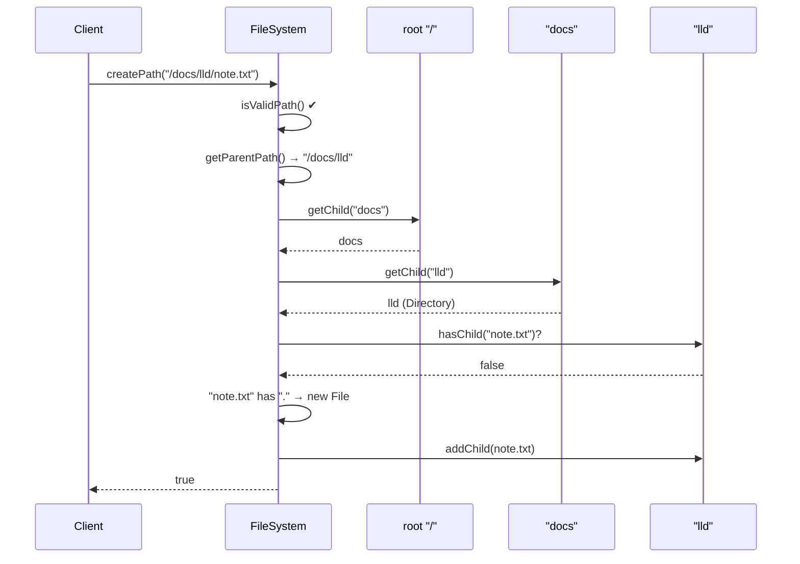

### 5.2 `deletePath("/x")`

1. Validate the path, refuse to delete `/`.
2. Find the parent (`/`) with `getNode`.
3. Call `removeChild("x")` on the parent.

Because `x` is removed from its parent's map, the whole subtree (`/x/y/z.md`) becomes unreachable and is garbage-collected — the in-memory equivalent of `rm -r`.

### 5.3 `display()`

`display()` is called on the root `Directory`, which prints itself and calls `display(depth + 1)` on each child. Files print themselves and stop. This recursive delegation is exactly what the Composite Pattern gives us.

---

## 6. Complexity Analysis

Let **L** = number of segments in the path, **N** = total nodes in the tree.

| Operation | Time | Notes |
|---|---|---|
| `createPath` | O(L) | One hash lookup per segment (TreeMap: O(L · log k), k = children per dir) |
| `get` / `getNode` | O(L) | Same traversal |
| `deletePath` | O(L) | Traverse to parent + one remove |
| `setFileContent` / `getFileContent` | O(L + C) | C = content length |
| `display` | O(N) | Visits every node once |
| **Space** | O(N + total content) | One node per path segment |

> Splitting the string itself is O(|path|) — in practice the path length dominates the cost of the lookups.

---

## 7. What Was Corrected From the Original Draft

| # | Problem in original draft | Fix |
|---|---|---|
| 1 | `private Strin name;` — typo | `String` |
| 2 | `isValidPath` returned `!path.startsWith("/")` — logic was **inverted**, so every valid path was rejected | Now requires a leading `/`, rejects trailing `/` and empty segments |
| 3 | `Directory` constructor was named `File(...)` — compile error | `Directory(String name)` |
| 4 | `File.setContent()` called `updateModifiedTime()`, which did not exist | Added protected `touch()` in the base class |
| 5 | `File` had no `getContent()` | Added |
| 6 | `node.isFIle()` — typo | `isFile()` |
| 7 | `FileSysmNode newNode` — typo | `FileSystemNode` |
| 8 | `getContentFromFile` returned `false` from a `String` method, and the client called `getFileContent` (name mismatch) | Renamed to `getFileContent`, returns `null` on failure |
| 9 | `createPath` silently created missing parents, which **contradicts** the stated rule ("return false if the parent doesn't exist") | `createPath` follows the rule; a separate `createPathRecursive` gives `mkdir -p` behaviour |
| 10 | `children` map lived in the base class, so a `File` could have children | Moved into `Directory` (safe Composite) |
| 11 | Unused `extractExtension` copy inside `Directory` | Removed |
| 12 | Missing imports (`Map`, `HashMap`, `Collection`, `LocalDateTime`, `Scanner`) | Added |
| 13 | `HashMap` gave random `display()` order | `TreeMap` for sorted, deterministic output |
| 14 | Empty "Trie Node Structure" code block and broken image links | Replaced with the LeetCode `TrieNode` code and Mermaid diagrams |
| 15 | Client's "Unknown command" message omitted `create` | Lists all commands |

---

## 8. Future Improvement — Backing the Design With a Real Storage Device

Our design keeps everything in **RAM** — power off and it's gone. A real file system has to persist the same tree onto a **block device** (HDD, SSD, USB stick), which only understands one thing:

> *"Read block #N"* and *"Write these 4096 bytes to block #N."*

The disk has no idea what a "file" or a "directory" is. The file system's whole job is to translate our nice tree into numbered blocks — and back.

### 8.1 Mapping our classes to on-disk structures

| In-memory LLD | Real file system equivalent |
|---|---|
| `FileSystemNode` (metadata) | **Inode** — fixed-size record holding type, size, timestamps, permissions, and pointers to data blocks |
| `File.content` (a `String`) | One or more **data blocks** on disk, referenced by the inode |
| `Directory.children` (a `Map`) | A **directory file** whose data blocks contain `(name → inode number)` entries |
| Java object reference | **Inode number** (an integer index into the inode table) |
| `new File(...)` | Allocate a free inode from the **inode bitmap** |
| Growing `content` | Allocate free blocks from the **block bitmap** |
| `root` field | A well-known inode number (inode **2** in ext2/3/4) |
| JVM garbage collector | Explicit freeing: bitmaps updated when link count drops to 0 |
| — (nothing) | **Superblock**: global info (block size, counts, where tables live) |
| — (nothing) | **Journal**: crash safety |

### 8.2 Layered architecture

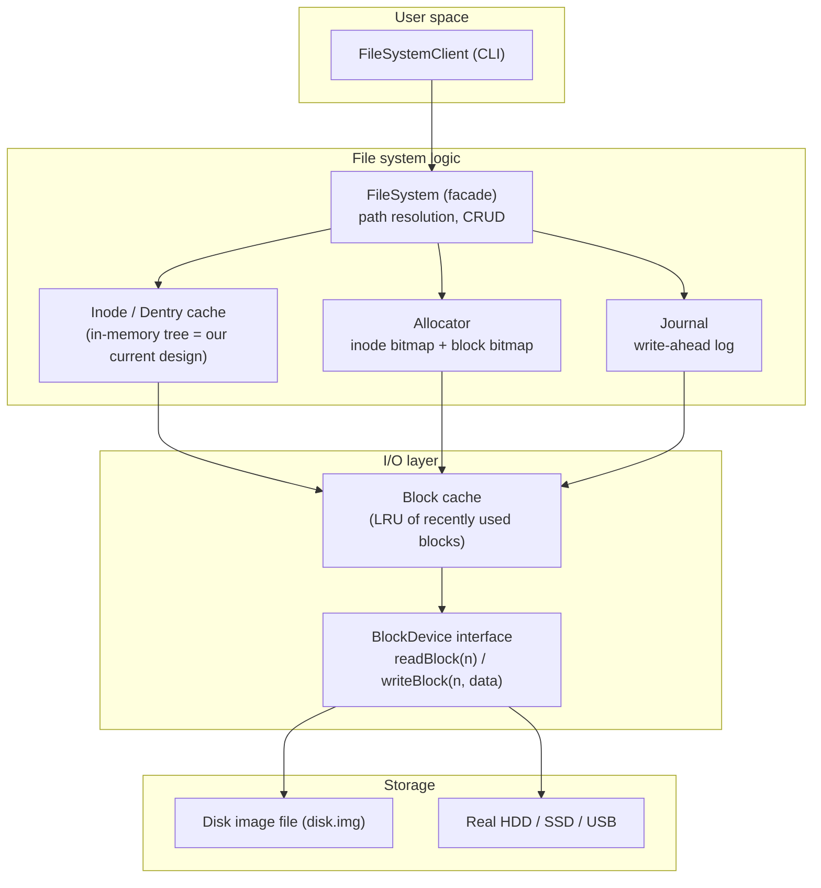

The key idea: **our current in-memory tree becomes the cache**. The source of truth moves to the disk; nodes are loaded lazily when a path is first resolved and written back when they change.

### 8.3 On-disk layout (ext2-style)


If the Mermaid `block-beta` diagram doesn't render in your viewer, here's the same layout in text:

```text
+------------+--------------+--------------+------------------------+--------------------------------+
| Superblock | Inode bitmap | Block bitmap |      Inode table       |          Data blocks           |
|  block 0   | 1 bit/inode  | 1 bit/block  | inode 1 | inode 2 | ... | blk | blk | blk | blk | ...    |
+------------+--------------+--------------+------------------------+--------------------------------+
```

- **Superblock** — magic number, block size (e.g. 4 KiB), total/free inode and block counts, location of each region.
- **Inode bitmap** — bit *i* = 1 means inode *i* is in use.
- **Block bitmap** — bit *j* = 1 means data block *j* is in use.
- **Inode table** — array of fixed-size inodes (e.g. 128 or 256 bytes each).
- **Data blocks** — actual bytes of files and directory listings.

### 8.4 How an inode points to data

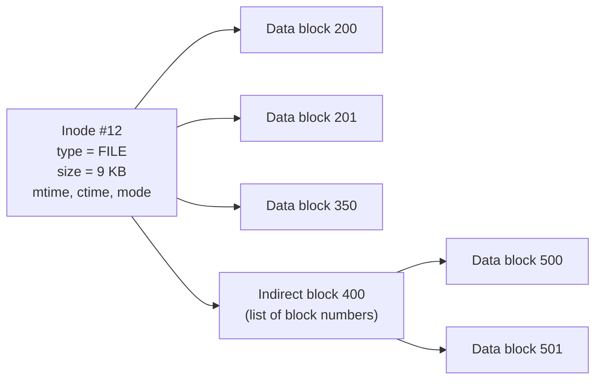

- **Direct pointers** (ext2/3: 12 of them) cover small files.
- **Indirect / double-indirect / triple-indirect** blocks hold more pointers for large files.
- **ext4, XFS, NTFS, Btrfs** use **extents** instead: one entry says *"blocks 500–1499"* — much more compact for large, contiguous files.

### 8.5 How a directory is stored

A directory is just a special file whose data is a list of entries:

```text
Directory inode #2 ("/")  → data block 100:
┌──────────────┬────────────┐
│ name         │ inode #    │
├──────────────┼────────────┤
│ .            │ 2          │
│ ..           │ 2          │
│ docs         │ 11         │
│ x            │ 15         │
└──────────────┴────────────┘

Directory inode #11 ("/docs") → data block 101:
│ .   │ 11 │   │ ..  │ 2 │   │ lld │ 12 │
```

Important consequence: **the file name lives in the directory, not in the inode.** That is why hard links (`ln`) can give one inode several names, and why renaming a file in the same directory is cheap — only the directory entry changes.

### 8.6 Path resolution on disk: `read /docs/lld/note.txt`

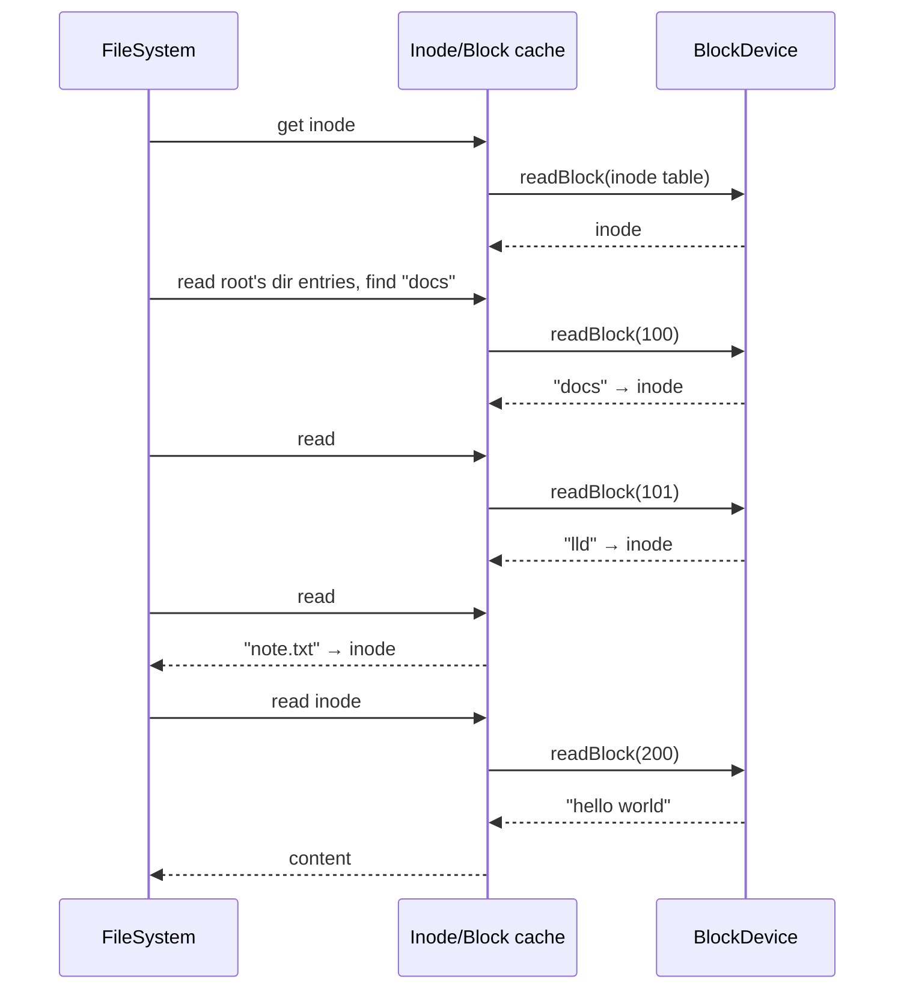

The second time the same path is read, everything comes from the cache — no disk I/O at all. This is exactly what Linux's **dentry cache** and **page cache** do.

### 8.7 Write path with journaling: `create /docs/lld/a.txt`

Creating one file touches **several** blocks: the inode bitmap, the inode table, the parent directory's data block, and maybe the block bitmap. If power fails halfway, the disk is left inconsistent (e.g. a bit marks an inode as used, but no directory points to it — a leak).

A **journal** (write-ahead log) solves this:

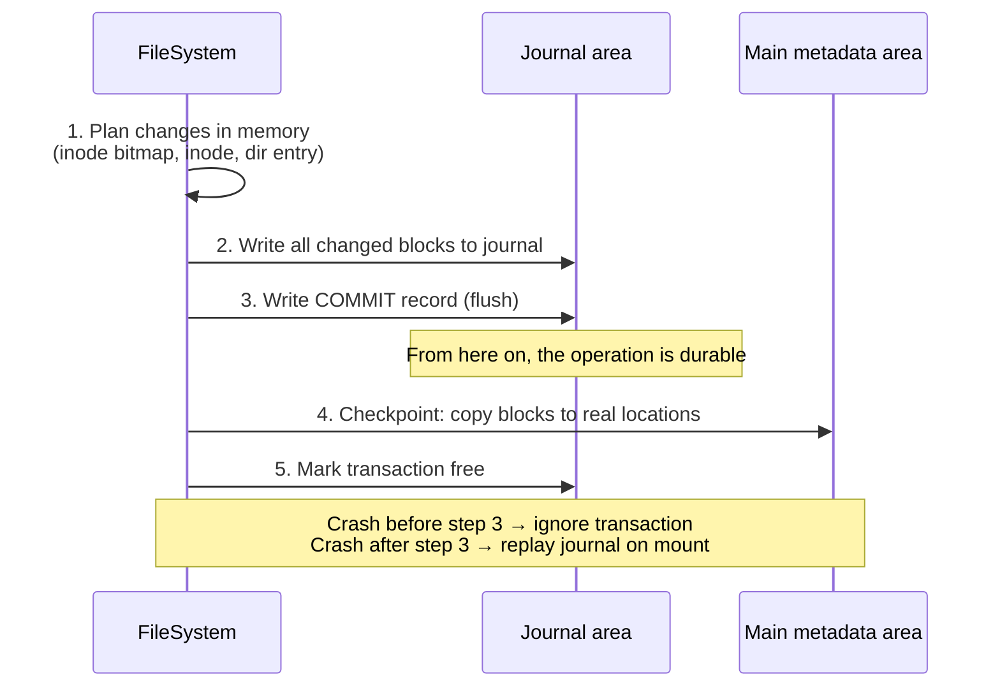

### 8.8 Interfaces to add to our LLD

```java
/** Raw storage — the only thing a disk understands. */
public interface BlockDevice {
    int blockSize();                       // e.g. 4096
    long blockCount();
    byte[] readBlock(long blockNo);
    void writeBlock(long blockNo, byte[] data);
    void flush();                          // force data to stable storage (fsync)
}

/** Simplest implementation: a disk image file on the host OS. */
public class FileBackedBlockDevice implements BlockDevice { /* RandomAccessFile + seek */ }

/** On-disk metadata record (replaces the fields in FileSystemNode). */
public final class Inode {
    int    inodeNo;
    byte   type;            // FILE or DIRECTORY
    long   size;
    long   createdAt, modifiedAt;
    int    linkCount;
    long[] directBlocks = new long[12];
    long   indirectBlock;
}

/** Hands out free inodes / blocks by scanning the bitmaps. */
public interface Allocator {
    int  allocateInode();
    void freeInode(int inodeNo);
    long allocateBlock();
    void freeBlock(long blockNo);
}

/** Groups multiple block writes into one atomic, crash-safe transaction. */
public interface Journal {
    Transaction begin();
    void commit(Transaction tx);   // write to log + commit record + flush
    void recover();                // replay committed transactions on mount
}
```

### 8.9 Ways to try this for real

| Approach | What you do | Difficulty |
|---|---|---|
| **Disk image file** | Implement `FileBackedBlockDevice` over a 64 MB `disk.img` using `RandomAccessFile`. Format it with your own superblock/bitmaps/inode table. | ⭐⭐ |
| **FUSE (Filesystem in Userspace)** | Expose your file system to the OS so `ls`, `cat`, `cp` work on it. Java: *jnr-fuse*; Python: *fusepy*; Rust: *fuser*. | ⭐⭐⭐ |
| **Real USB stick / partition** | Point `BlockDevice` at `/dev/sdX` (Linux, root required). ⚠️ Destroys existing data. | ⭐⭐⭐ |
| **Kernel module** | Write a VFS driver in C, like ext4 itself. | ⭐⭐⭐⭐⭐ |

---

## 9. How a Real File System Works

### 9.1 The full stack (Linux)

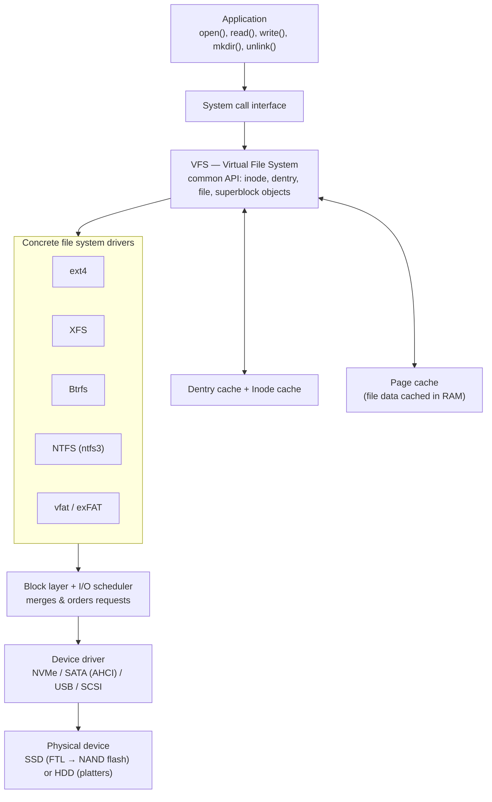

- **VFS** is itself an application of the same idea as our `FileSystemNode` abstraction: one common interface, many implementations. `ls` doesn't care whether it is reading ext4 or NTFS. (Windows has an equivalent layered design with the I/O Manager and file system drivers.)
- **Page cache** means most `read()` calls never touch the disk; `write()` usually just dirties a page in RAM, and the kernel flushes it later (or immediately on `fsync()`).
- **SSDs** add one more translation layer inside the drive itself — the **FTL (Flash Translation Layer)** — which maps logical block numbers to physical flash pages and does wear-levelling.

### 9.2 What happens on `open("/docs/lld/note.txt")` + `read()`

1. **Syscall** enters the kernel.
2. **VFS** splits the path and walks it, checking the **dentry cache** for each component.
3. On a cache miss, VFS asks the concrete FS (e.g. ext4) to **look up** the name in the parent directory's blocks.
4. The FS returns the **inode**; VFS checks permissions and creates a **file descriptor**.
5. `read()` checks the **page cache**; on a miss, the FS maps file offset → disk block (via extents), and the **block layer** issues the I/O.
6. The data lands in the page cache and is copied to the application's buffer.

### 9.3 Core techniques every modern FS uses

| Technique | Problem it solves |
|---|---|
| **Inodes / MFT records** | Separate metadata from names; enable hard links |
| **Extents** | Describe large contiguous ranges compactly (instead of one pointer per block) |
| **B-trees / H-trees** | Fast lookup in directories with millions of entries |
| **Journaling** | Crash consistency without a slow full-disk check (`fsck`) |
| **Copy-on-write (CoW)** | Never overwrite live data → cheap snapshots, no journal needed |
| **Delayed allocation** | Pick disk locations at flush time → less fragmentation |
| **Checksums** | Detect silent corruption ("bit rot") |
| **Allocation groups** | Split disk into independent regions for parallel allocation |
| **TRIM / discard** | Tell SSDs which blocks are free so the FTL can erase them efficiently |

### 9.4 Journaling vs copy-on-write

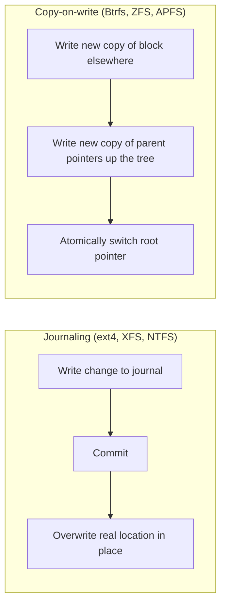

- **Journaling** writes metadata twice (log + final place) but keeps data in place — good for databases and VM images.
- **CoW** never overwrites; old versions remain until freed — snapshots become almost free, but random overwrites cause fragmentation.

---

## 10. Comparing Real File Systems

### 10.1 The Linux "ext" family

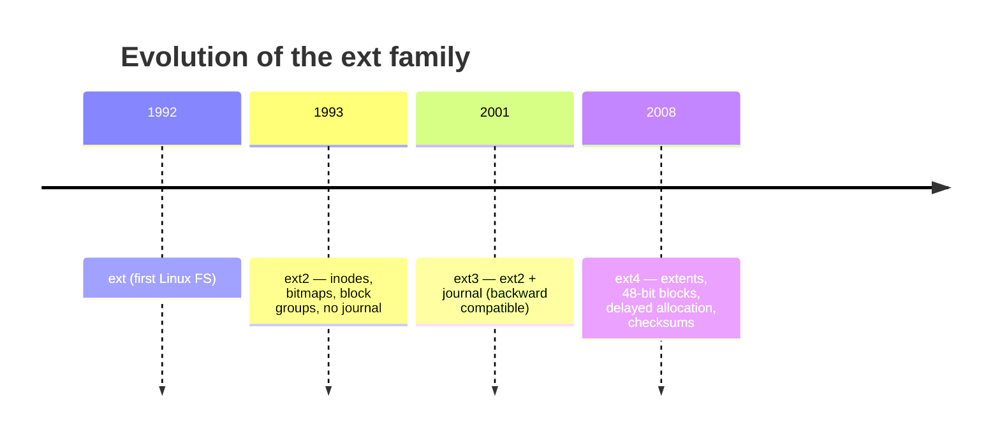

### 10.2 Feature comparison

| | **ext2** | **ext3** | **ext4** | **XFS** | **NTFS** | **Btrfs** | **ZFS** | **FAT32** | **exFAT** | **APFS** |
|---|---|---|---|---|---|---|---|---|---|---|
| **Origin** | Linux, 1993 | Linux, 2001 | Linux, 2008 | SGI IRIX 1994, Linux 2001 | Microsoft, 1993 | Oracle → Linux, 2009 | Sun, 2005 | Microsoft, 1996 | Microsoft, 2006 | Apple, 2017 |
| **Main OS** | Linux | Linux | Linux (default on many distros) | Linux (default on RHEL) | Windows | Linux (default on Fedora/openSUSE) | FreeBSD, Linux, illumos | Everything | Everything (SD/USB) | macOS / iOS |
| **Crash consistency** | None (needs `fsck`) | Journal | Journal | Metadata journal | Journal (`$LogFile`) | CoW | CoW + intent log | None | None | CoW |
| **Block mapping** | Indirect blocks | Indirect blocks | Extents | Extents (B+tree) | Runs (extents) in MFT | Extents in B-trees | Block pointers in Merkle tree | FAT chain | FAT chain / bitmap | Extents (B-trees) |
| **Max file size** | ~2 TiB | ~2 TiB | 16 TiB | 8 EiB | 16 TiB → 8 PiB (depends on cluster size/Windows version) | 16 EiB | 16 EiB | **4 GiB − 1** | 16 EiB | 8 EiB |
| **Max volume** | ~16 TiB (4K blocks) | ~16 TiB (4K blocks) | 1 EiB | 8 EiB | 256 TiB → 8 PiB | 16 EiB | 256 ZiB-scale | ~2 TiB (practical) | 128 PiB | 8 EiB |
| **Snapshots** | ❌ | ❌ | ❌ | ❌ | Volume Shadow Copy (OS-level) | ✅ | ✅ | ❌ | ❌ | ✅ |
| **Data checksums** | ❌ | ❌ | Metadata only | Metadata only (v5) | ❌ | ✅ | ✅ | ❌ | ❌ | Metadata only |
| **Built-in RAID / pooling** | ❌ | ❌ | ❌ | ❌ | ❌ (Storage Spaces is separate) | ✅ RAID 0/1/10 | ✅ RAID-Z, mirrors | ❌ | ❌ | Containers share space |
| **Compression** | ❌ | ❌ | ❌ | ❌ | ✅ | ✅ | ✅ | ❌ | ❌ | ✅ |
| **Shrink online/offline** | Offline | Offline | Offline | ❌ cannot shrink | ✅ | ✅ online | ❌ (limited) | — | — | ✅ |
| **Permissions** | POSIX | POSIX + ACL | POSIX + ACL | POSIX + ACL | Windows ACLs | POSIX + ACL | POSIX + NFSv4 ACL | None | None | POSIX + ACL |
| **Best for** | Tiny/flash devices where journal is unwanted | Legacy systems | General-purpose Linux | Very large files & volumes, parallel I/O | Windows system & data drives | Snapshots, rollback, home NAS | Data integrity, servers, NAS | Maximum compatibility | USB sticks, SD cards, cameras | Apple SSDs |

> Size limits depend on block/cluster size and implementation version; numbers above are typical maximums for common configurations.

### 10.3 Short profile of each

**ext2** — The classic Unix design: superblock, block groups, inode bitmap, block bitmap, inode table, indirect pointers. Simple and fast, but after a crash a full `fsck` must scan the whole disk, which can take hours on large drives.

**ext3** — ext2 + a **journal** (`jbd`). An ext2 volume can be upgraded in place. Three journaling modes: `journal` (data + metadata), `ordered` (default; data written before metadata commit), `writeback` (metadata only). Still uses indirect blocks, so very large files are inefficient.

**ext4** — Today's default on Debian/Ubuntu. Adds **extents**, 48-bit block numbers (huge volumes), **delayed allocation**, multi-block allocation, **HTree** directory indexes, journal and metadata **checksums**, nanosecond timestamps, and fast `fsck`. A conservative, very well-tested evolution.

**XFS** — Built by SGI for supercomputers and media workloads. Splits the disk into **allocation groups**, each with its own free-space and inode B+trees, so many CPUs can allocate in parallel. Excellent for large files and high-throughput servers; default on Red Hat Enterprise Linux. Cannot be shrunk.

**NTFS** — Windows' native FS. Everything, including metadata, is a file; the **Master File Table (MFT)** holds one record per file, and tiny files fit *inside* the MFT record. Supports ACLs, journaling, compression, encryption (EFS), hard links, and **alternate data streams**. Linux reads/writes it through the in-kernel `ntfs3` driver.

**Btrfs** — Copy-on-write B-tree FS for Linux: **snapshots**, **subvolumes**, data and metadata **checksums**, transparent compression, built-in RAID 0/1/10, online resize, send/receive for incremental backups. RAID 5/6 modes are still considered not production-safe.

**ZFS** — Combines volume manager + file system: you add disks to a **pool**, and file systems draw space from it. End-to-end checksums with **self-healing** when redundancy exists, RAID-Z, snapshots, clones, compression, deduplication. Very robust, but memory-hungry and, due to licensing, distributed outside the mainline Linux kernel.

**FAT32** — Ancient and simple: a **File Allocation Table** is a linked list of clusters per file. No permissions, no journal, and a hard **4 GiB per-file limit**. Survives because every device on earth can read it (also used for UEFI boot partitions).

**exFAT** — FAT modernised for flash media: removes the 4 GiB limit, adds a free-space bitmap, still lightweight. The standard for SDXC cards; supported by Windows, macOS, Linux, cameras and consoles.

**APFS** — Apple's CoW FS optimised for SSDs: snapshots, clones (instant file copy), space sharing between volumes in a container, and native encryption. Used on every modern Apple device.

**Bonus — F2FS** — Samsung's *Flash-Friendly File System*, log-structured to match how NAND flash works; common on Android phones.

### 10.4 Which one should I pick?

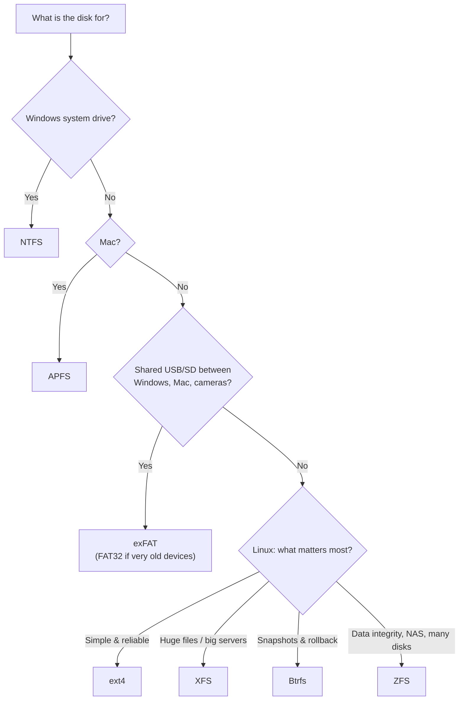

---

## 11. Why Do So Many File Systems Exist?

Because **no single design can be best at everything** — every file system is a set of trade-offs, made for a particular era, device and workload.

### 11.1 Hardware keeps changing

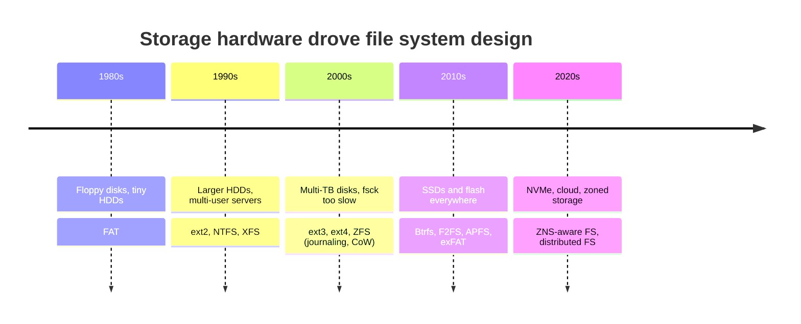

- Spinning disks reward **sequential layout** (seek time is expensive).
- SSDs have no seek time but need **TRIM**, wear-levelling and avoidance of small random overwrites.
- Disks grew from MBs to tens of TBs — old 32-bit block numbers and full-disk `fsck` stopped being acceptable.

### 11.2 Workloads are different

| Workload | What it needs | Good fit |
|---|---|---|
| Desktop / laptop | Reliable, low maintenance | ext4, NTFS, APFS |
| Video editing, scientific data | Huge sequential files, parallel I/O | XFS |
| Database server | Predictable in-place writes, low latency | XFS, ext4 |
| NAS / backup server | Integrity, snapshots, many disks | ZFS, Btrfs |
| Phone / SD card | Flash-friendly, low CPU, low RAM | F2FS, exFAT |
| Bootloader / firmware | Dead simple to implement | FAT32 |

### 11.3 Fundamental trade-offs

| Trade-off | One side | Other side |
|---|---|---|
| Simplicity ↔ Features | FAT: easy to implement everywhere | ZFS: snapshots, RAID, checksums — but complex |
| Speed ↔ Safety | No journal = fastest writes | Full data journal / checksums = safer, slower |
| In-place ↔ Copy-on-write | Good for databases, less fragmentation | Free snapshots, never corrupts old data |
| Memory use ↔ Performance | Small embedded systems | Big caches (ZFS ARC) |
| Compatibility ↔ Innovation | FAT/exFAT read everywhere | New FS needs new drivers |

### 11.4 Other reasons

- **Operating-system ownership** — Microsoft, Apple and the Linux community each designed their own FS, tuned to their kernel, permission model and users.
- **Backward compatibility** — you can't break billions of existing disks, so new designs are added *alongside* old ones rather than replacing them (ext2 → ext3 → ext4).
- **Licensing** — e.g. ZFS's CDDL licence is incompatible with the Linux kernel's GPL, which was a major motivation for Btrfs.
- **Special purposes** — network FS (NFS, SMB), distributed FS (HDFS, Ceph, GlusterFS), in-memory FS (tmpfs), read-only compressed FS (SquashFS, used by live ISOs), optical (ISO 9660, UDF), and virtual FS (`/proc`, `/sys`) that don't store data at all.

> **The LLD takeaway:** this is the same lesson as our `FileSystemNode` abstraction. Define a common interface (VFS / `FileSystemNode`), and you can plug in as many specialised implementations as the world needs.

---

## 12. Summary

- A file system is a **tree**; a **Trie keyed by path segment** gives O(L) create/lookup and natural parent checking.
- The **Composite Pattern** (`FileSystemNode` → `File` / `Directory`) lets clients treat files and directories uniformly, with recursion doing the work in `display()`.
- To persist it, swap Java references for **inode numbers**, `Map`s for **directory entries in data blocks**, `String` content for **data blocks**, and add a **superblock, bitmaps, a block cache and a journal** on top of a `BlockDevice` interface.
- Real systems (ext4, XFS, NTFS, Btrfs, ZFS, APFS…) all implement these same ideas, differing in **how they map blocks, how they stay crash-consistent, and what extra features they provide**.
- Many file systems exist because **hardware, workloads, operating systems, licences and priorities differ** — and the VFS abstraction makes it cheap to support all of them side by side.
