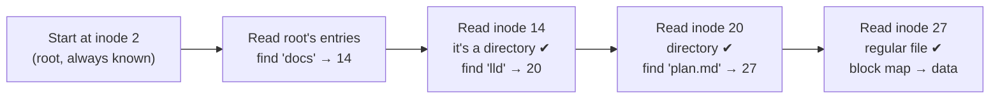
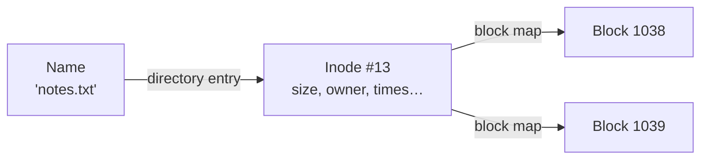
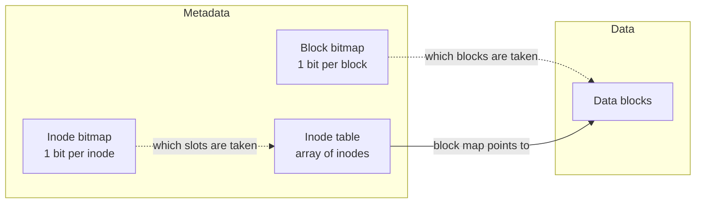
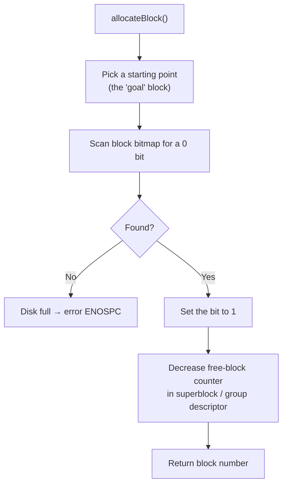
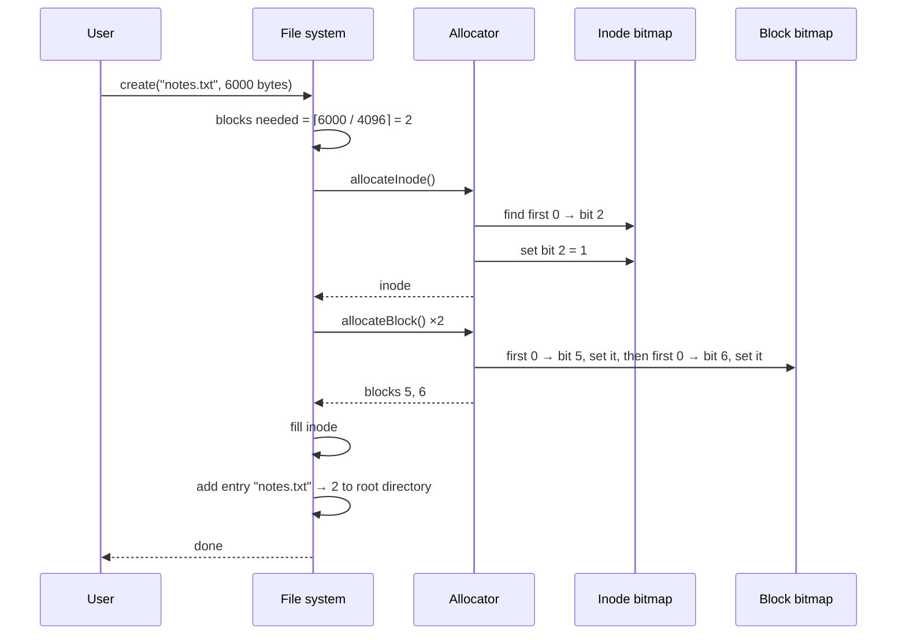
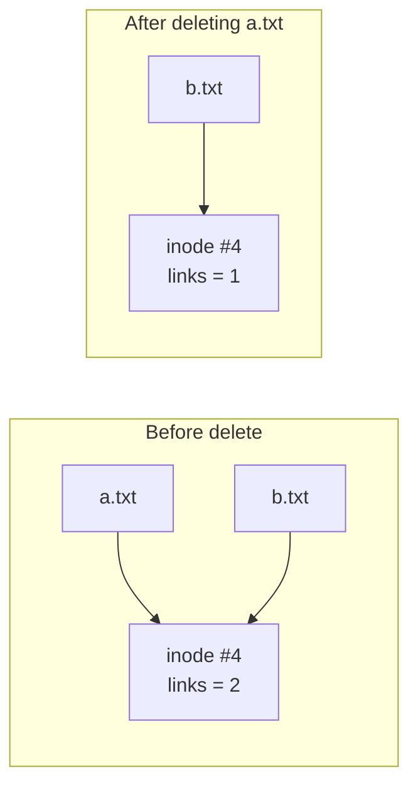
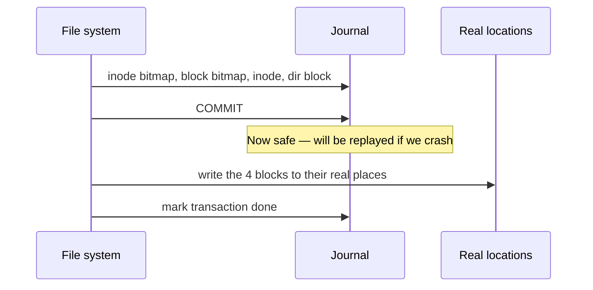
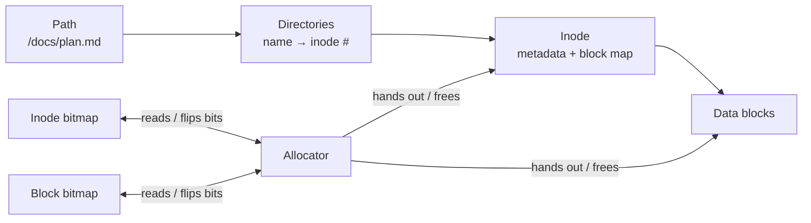

# Understanding Inodes, Bitmaps and the Allocator — A Beginner's Step-by-Step Guide

> **Who this is for:** anyone who has used files and folders all their life and now wants to know what actually happens on the disk. No prior operating-systems knowledge needed — every term is explained the first time it appears, and every idea comes with a worked example.
>
> **What you'll be able to do at the end:** explain what an inode is, how a file system finds a file's data from its name, what a bitmap is and why file systems use them, how an allocator picks free space, and read the raw bitmaps of a real ext4 disk yourself.

---

## Table of Contents

1. [Step 1 — A disk is just a long row of numbered boxes](#step-1--a-disk-is-just-a-long-row-of-numbered-boxes)
2. [Step 2 — The problem: what must a file system remember?](#step-2--the-problem-what-must-a-file-system-remember)
3. [Step 3 — The inode: an ID card for every file](#step-3--the-inode-an-id-card-for-every-file)
4. [Step 4 — The inode table and inode numbers](#step-4--the-inode-table-and-inode-numbers)
5. [Step 5 — Where do file names live? Directories](#step-5--where-do-file-names-live-directories)
6. [Step 6 — How an inode finds the file's data](#step-6--how-an-inode-finds-the-files-data)
7. [Step 7 — The bookkeeping problem: which boxes are free?](#step-7--the-bookkeeping-problem-which-boxes-are-free)
8. [Step 8 — What is a bitmap?](#step-8--what-is-a-bitmap)
9. [Step 9 — Why bitmaps? The numbers](#step-9--why-bitmaps-the-numbers)
10. [Step 10 — Two bitmaps: the inode bitmap and the block bitmap](#step-10--two-bitmaps-the-inode-bitmap-and-the-block-bitmap)
11. [Step 11 — The Allocator: the one who hands out space](#step-11--the-allocator-the-one-who-hands-out-space)
12. [Step 12 — Putting it all together: a complete walkthrough](#step-12--putting-it-all-together-a-complete-walkthrough)
13. [Step 13 — Deleting files, link counts and hard links](#step-13--deleting-files-link-counts-and-hard-links)
14. [Step 14 — Running out of inodes (while the disk has space!)](#step-14--running-out-of-inodes-while-the-disk-has-space)
15. [Step 15 — What if the power fails mid-write?](#step-15--what-if-the-power-fails-mid-write)
16. [Step 16 — Hands-on lab: look at a real ext4 disk](#step-16--hands-on-lab-look-at-a-real-ext4-disk)
17. [Step 17 — Block groups: how ext4 scales this up](#step-17--block-groups-how-ext4-scales-this-up)
18. [Step 18 — Inodes in other file systems](#step-18--inodes-in-other-file-systems)
19. [The complete simulator code](#the-complete-simulator-code)
20. [Cheat sheet, glossary and self-check](#cheat-sheet-glossary-and-self-check)

---

## Step 1 — A disk is just a long row of numbered boxes

Forget files and folders for a moment. To the computer, a storage device (hard disk, SSD, USB stick) is nothing more than **a very long row of equal-sized boxes, each with a number**.

```text
 ┌──────┬──────┬──────┬──────┬──────┬──────┬──────┬──────┬─────────────┐
 │  0   │  1   │  2   │  3   │  4   │  5   │  6   │  7   │  ... 268 M  │
 └──────┴──────┴──────┴──────┴──────┴──────┴──────┴──────┴─────────────┘
   each box = one block = 4096 bytes (4 KiB)
```

- The hardware itself works in **sectors** (traditionally 512 bytes; modern drives 4096 bytes).
- The file system groups sectors into **blocks**, usually **4 KiB** each. A block is the smallest unit the file system reads or writes.
- The disk only understands two commands: **"give me block N"** and **"store these 4096 bytes in block N"**.

> 🏨 **Analogy — a hotel.** Think of the disk as a huge hotel with numbered rooms. Every room is the same size. The building itself has no idea who is staying in which room — that information lives in the **reception desk's records**. A file system *is* that reception desk.

**Key point:** the disk does not know what a "file" is. It has no names, no folders, no sizes. Everything else in this guide is about the records a file system keeps *on that same disk* so it can turn "boxes of bytes" into "files and folders".

---

## Step 2 — The problem: what must a file system remember?

Suppose you save a 6000-byte file called `notes.txt`. A 4096-byte block can't hold it, so it needs **2 blocks**. Now the file system must be able to answer, later, after a reboot:

| # | Question | Example answer |
|---|---|---|
| 1 | What is this thing — a file or a folder? | regular file |
| 2 | How big is it exactly? | 6000 bytes (not 8192 — the 2nd block is only partly used) |
| 3 | Who owns it, who may read/write it? | user `alice`, permissions `rw-r--r--` |
| 4 | When was it created / changed / read? | timestamps |
| 5 | **Which blocks hold its bytes, and in what order?** | blocks 1038, 1039 |
| 6 | What is it called and which folder is it in? | `notes.txt` in `/` |
| 7 | Which blocks are still free for the *next* file? | everything except the used ones |

Questions 1–5 are answered by the **inode**. Question 6 is answered by **directories**. Question 7 is answered by **bitmaps** and the **allocator**. We'll take them one at a time.

---

## Step 3 — The inode: an ID card for every file

An **inode** (short for **index node**, a term from early Unix) is a small, fixed-size record — typically **256 bytes** on ext4 — that stores **everything about a file except its name and its actual content**.

> 🪪 **Analogy — a hotel guest card.** Reception keeps one card per guest: check-in time, how many rooms they have, which room numbers, who's allowed to visit. The card doesn't contain the guest's luggage (the data) — it tells you *where* the luggage is.

### What's inside an inode

```text
 ┌───────────────────────────── inode #13 ─────────────────────────────┐
 │  type .............. regular file                                   │
 │  permissions ....... rw-r--r--   (0644)                             │
 │  owner / group ..... uid 1000 / gid 1000                            │
 │  size .............. 6000 bytes                                     │
 │  link count ........ 1          (how many names point to this inode)│
 │  timestamps ........ atime, mtime, ctime, crtime                    │
 │  block count ....... how much disk space is actually used           │
 │  block map ......... WHERE the data lives → blocks 1038, 1039       │
 │  flags, checksum ... extents in use, inode checksum, …              │
 └─────────────────────────────────────────────────────────────────────┘
          ✗ no file name        ✗ no file content
```

| Field | Meaning | Why it's needed |
|---|---|---|
| **mode** | file type (file, directory, symlink, device…) + permission bits | `ls -l`'s first column; access checks |
| **uid / gid** | owner and group | permission checks |
| **size** | exact length in bytes | so you don't read garbage past the end of the last block |
| **links** | number of directory entries (names) pointing to this inode | decides when the file can really be freed |
| **atime / mtime / ctime** | last access, last content modification, last inode change | backups, `make`, `ls -lt` |
| **crtime** | creation ("birth") time (ext4) | auditing |
| **block map** | list of block numbers, or extents | finding the data — the most important field |

### Why is the name *not* in the inode?

Because one file can have **several names** (hard links, Step 13), and renaming a file shouldn't require touching the file itself. Names live in directories; the inode is the file's true identity.

You can see a real inode on Linux with `stat`:

```text
$ stat notes.txt
  File: notes.txt
  Size: 6000        Blocks: 16         IO Block: 4096   regular file
Device: 8,2         Inode: 1311234     Links: 1
Access: (0644/-rw-r--r--)  Uid: ( 1000/   alice)   Gid: ( 1000/   alice)
Modify: 2026-11-04 09:12:31.000000000 +0530
Change: 2026-11-04 09:12:31.000000000 +0530
 Birth: 2026-11-04 09:12:31.000000000 +0530
```

> 💡 **"Blocks: 16" puzzle.** The file uses 2 file-system blocks of 4 KiB, but `stat` counts in old-style **512-byte units**: 8192 ÷ 512 = **16**. Size (6000) is what the file *contains*; Blocks is what it *occupies* on disk.

---

## Step 4 — The inode table and inode numbers

Inodes are stored in a reserved area of the disk called the **inode table** — simply an array of inodes, one after another. An inode's position in that array is its **inode number**.

```text
 Inode table (each slot = 256 bytes)
 ┌─────────┬─────────┬─────────┬─────────┬─────────┬─────────┬───────┐
 │ inode 1 │ inode 2 │ inode 3 │   ...   │ inode 12│ inode 13│  ...  │
 │ (bad    │ (root   │         │         │ hello   │ notes   │       │
 │ blocks) │  "/")   │         │         │  .txt   │  .txt   │       │
 └─────────┴─────────┴─────────┴─────────┴─────────┴─────────┴───────┘
```

Because every inode has the **same size**, finding inode *N* is just arithmetic — no searching:

```text
byte offset in table = (N − 1) × inode_size         (ext numbers inodes from 1)
block                = table_start + offset ÷ block_size
offset inside block  = offset mod block_size
```

**Worked example** (real numbers from the lab in Step 16): inode table starts at block **35**, inode size **256**, block size **4096**. Where is inode **13**?

```text
offset = (13 − 1) × 256 = 3072
block  = 35 + 3072 ÷ 4096 = 35 + 0 = 35
inside = 3072 mod 4096    = 3072
→ read block 35, take the 256 bytes starting at byte 3072.
```

That's why inode numbers matter: **an inode number is a direct address**.

Some inode numbers are reserved on ext2/3/4:

| Inode | Purpose |
|---|---|
| 1 | list of bad blocks |
| **2** | **root directory `/`** — the starting point of every path lookup |
| 3–10 | reserved (journal is 8, resize is 7, …) |
| 11 | `lost+found` (first normal inode) |
| 12+ | your files |

---

## Step 5 — Where do file names live? Directories

A **directory is just a special file** whose content is a table of `name → inode number` pairs (called **directory entries**, or *dentries*).

```text
 Directory "/"  (inode 2)            Directory "/docs" (inode 14)
 ┌──────────────┬─────────┐          ┌──────────────┬─────────┐
 │ name         │ inode # │          │ name         │ inode # │
 ├──────────────┼─────────┤          ├──────────────┼─────────┤
 │ .            │    2    │          │ .            │   14    │
 │ ..           │    2    │          │ ..           │    2    │
 │ lost+found   │   11    │          │ lld          │   20    │
 │ hello.txt    │   12    │          └──────────────┴─────────┘
 │ notes.txt    │   13    │
 │ docs         │   14    │
 └──────────────┴─────────┘
```

- `.` points to the directory itself; `..` points to its parent. For `/`, both are 2.
- `ls -i` shows the inode number next to each name.

### Path lookup, step by step: `open("/docs/lld/plan.md")`



Each `/` in a path means *"look up the next name in this directory, get an inode number, load that inode."* The OS keeps recently used lookups in memory (the **dentry cache**) so repeated opens are fast.

> 🏨 **Analogy:** the directory is the hotel's guest **register** (name → card number). The inode is the **guest card** (card number → room numbers). You never go from a name straight to rooms; you always go **name → inode → blocks**.



---

## Step 6 — How an inode finds the file's data

The **block map** is the most important part of the inode. There are two classic ways to store it.

### 6.1 Block pointers (ext2/ext3)

The inode holds **15 block-number slots** (each 4 bytes):

```text
 inode
 ┌───────────────┐
 │ slot 0  ──────┼──► data block
 │ slot 1  ──────┼──► data block
 │  ...          │        (12 DIRECT pointers)
 │ slot 11 ──────┼──► data block
 │ slot 12 ──────┼──► [ pointer block: 1024 numbers ] ──► 1024 data blocks          (single indirect)
 │ slot 13 ──────┼──► [ 1024 pointer blocks ] ──► [ 1024 each ] ──► data            (double indirect)
 │ slot 14 ──────┼──► [ ... three levels ... ] ──► data                             (triple indirect)
 └───────────────┘
```

- Small files (the vast majority) fit in the 12 **direct** pointers → found in one step.
- Bigger files use an **indirect block**: a whole data block filled with block numbers. A 4096-byte block holds 4096 ÷ 4 = **1024** numbers.

**How big can a file get?** (4 KiB blocks)

| Level | Blocks reachable | Data reachable |
|---|---|---|
| 12 direct | 12 | 48 KiB |
| single indirect | 1 024 | 4 MiB |
| double indirect | 1 024² = 1 048 576 | 4 GiB |
| triple indirect | 1 024³ ≈ 1.07 billion | 4 TiB |
| **total (theoretical)** | | **≈ 4 TiB** |

> In practice ext2/ext3 cap files at 2 TiB because of another 32-bit counter, but the tree idea is what matters: **small files are cheap, big files are possible.**

**Downside:** a 1 GiB file needs 262 144 individual block numbers stored across many pointer blocks — even if those blocks are all next to each other.

### 6.2 Extents (ext4, XFS, NTFS, Btrfs, APFS)

An **extent** says *"starting at file block X, the next N blocks are at disk blocks Y … Y+N−1"*. One extent can describe up to 32 768 blocks (128 MiB) on ext4.

```text
 Block pointers for a 6-block file:   [1038, 1039, 1040, 1041, 1042, 1043]   (6 numbers)
 Extent for the same file:            (file 0-5) → disk 1038-1043             (1 entry)
```

Real output from the lab (Step 16):

```text
$ debugfs -R "stat /notes.txt" disk.img
...
EXTENTS:
(0-1):1038-1039          ← file blocks 0–1 live in disk blocks 1038–1039
```

ext4's inode has room for **4 extents** directly; beyond that it builds a small **B-tree** of extents. A perfectly contiguous 100 GiB file can be described in a few hundred extents instead of 26 million pointers.

---

## Step 7 — The bookkeeping problem: which boxes are free?

We now know how to *find* a file. But when you create a new one, the file system needs to quickly answer:

- **Which inode slot is free?**
- **Which data blocks are free?**

### Option A — scan every inode

Read every inode and collect every block it uses; whatever's left is free. With 67 million inodes on a 1 TiB disk, that's gigabytes of reads **every time you save a file**. ❌ Far too slow.

### Option B — keep a list of free block numbers

`free = [5, 6, 11, 12, 13, ...]` — 4 bytes per free block. On an empty 1 TiB disk that's 268 million numbers = **1 GiB** of list, and checking "is block 7 free?" means searching the list. ❌ Big and awkward.

### Option C — a linked chain of free blocks (FAT's approach)

Every block entry points to the next free one. Finding *one* free block is easy, but finding **many blocks next to each other** (for a fast, unfragmented file) is slow. ⚠️

### Option D — a **bitmap** ✅

Keep **one bit per block**: `0` = free, `1` = used. That's the approach used by ext2/3/4, NTFS (`$Bitmap`), and many others. Let's understand it properly.

> 🏨 **Analogy:** instead of a notebook listing free room numbers, reception has a **wall board with one light per room** — on = occupied, off = free. One glance tells you everything, and the board is tiny compared to the hotel.

---

## Step 8 — What is a bitmap?

### 8.1 Bits and bytes, quickly

- A **bit** is the smallest unit of information: `0` or `1`.
- A **byte** is 8 bits, e.g. `10110000`.
- A **bitmap** (also called a *bit array* or *bitset*) is a sequence of bits where **bit number *n* describes item number *n***.

### 8.2 A tiny example: a disk with 16 blocks

```text
 block #     0  1  2  3   4  5  6  7   8  9 10 11  12 13 14 15
 bitmap      1  1  1  1   1  1  1  0   0  1  1  0   0  0  0  0
             └──────────┘ └──────────┘ └──────────┘ └───────────┘
               byte 0       (still byte 0) byte 1       (byte 1)
```

Reading it:

- Blocks 0–6 are used, block **7 is free**, 8 is free, 9–10 used, 11–15 free.
- 16 blocks need only **16 bits = 2 bytes**.
- "Is block 9 free?" → look at bit 9 → `1` → no, it's used. **One lookup, no searching.**

### 8.3 Finding bit *n* inside the bytes

Computers can't address single bits directly; they read whole bytes. So for item *n*:

```text
byte index = n ÷ 8          (integer division)
bit index  = n mod 8        (remainder)
mask       = 1 << bit index (a byte with only that one bit set)
```

**Worked example — block 13:**

```text
byte index = 13 ÷ 8 = 1
bit index  = 13 mod 8 = 5
mask       = 1 << 5 = 0010 0000  (binary)  = 0x20 (hex) = 32 (decimal)
```

Now the three operations every bitmap needs:

| Operation | Code | What it does to byte 1 (`0000 0110` → blocks 9 and 10 used) |
|---|---|---|
| **test** — is it used? | `(bytes[1] & 0x20) != 0` | `0000 0110 & 0010 0000 = 0000 0000` → **free** |
| **set** — mark used | `bytes[1] \|= 0x20` | `0000 0110 \| 0010 0000 = 0010 0110` |
| **clear** — mark free | `bytes[1] &= ~0x20` | `0010 0110 & 1101 1111 = 0000 0110` |

> ⚠️ **Bit order.** ext2/3/4 store bit 0 as the **least significant** (rightmost) bit of each byte. So byte `0000 0110` means "bits 1 and 2 set" → items 9 and 10 in byte 1. When you dump a real bitmap in hex, remember that each byte reads **right-to-left**. We'll decode a real one in Step 16.

### 8.4 The same thing in Java

```java
class Bitmap {
    private final byte[] bytes;
    private final int size;

    Bitmap(int size) { this.size = size; this.bytes = new byte[(size + 7) / 8]; }

    boolean isUsed(int n) { return (bytes[n / 8] & (1 << (n % 8))) != 0; }
    void    set(int n)    { bytes[n / 8] |=  (1 << (n % 8)); }
    void    clear(int n)  { bytes[n / 8] &= ~(1 << (n % 8)); }

    /** First free bit at or after 'start', or -1. */
    int findFree(int start) {
        for (int i = start; i < size; i++) if (!isUsed(i)) return i;
        return -1;
    }
}
```

> 🚀 **Real systems are faster than this loop.** They check 64 bits at a time: if a 64-bit word equals `0xFFFF_FFFF_FFFF_FFFF`, all 64 blocks are used — skip it. Otherwise a single CPU instruction (*count trailing zeros* on the inverted word) finds the first free bit. That's 64 blocks examined per instruction.

---

## Step 9 — Why bitmaps? The numbers

Take a **1 TiB disk** with **4 KiB blocks**:

```text
number of blocks = 1 TiB ÷ 4 KiB = 2^40 ÷ 2^12 = 2^28 = 268,435,456 blocks
bitmap size      = 268,435,456 bits ÷ 8 = 33,554,432 bytes = 32 MiB
fraction of disk = 32 MiB ÷ 1 TiB ≈ 0.003 %
```

| Approach | Space for 1 TiB | "Is block N free?" | "Find 100 free blocks in a row" |
|---|---|---|---|
| Scan all inodes | 0 extra | read every inode 😱 | very slow |
| Free list (4-byte numbers) | up to **1 GiB** | search the list | sort and search |
| Linked chain (FAT) | 4 bytes per block | follow pointers | slow |
| **Bitmap** | **32 MiB, fixed** | **one bit test** | **scan for a run of 0s** — fast with 64-bit words |

### Why bitmaps win for classic file systems

1. **Tiny and fixed size.** Always exactly 1 bit per block, whether the disk is full or empty.
2. **O(1) check, set and clear.** Pure arithmetic, no searching.
3. **Locality is visible.** Free space that's physically next to each other is next to each other in the bitmap → easy to find **contiguous** runs, which keeps files unfragmented.
4. **Cache-friendly.** One 4 KiB bitmap block describes 32 768 blocks (128 MiB of disk) and fits easily in memory.
5. **Simple to keep consistent.** Updating one bit is one small write, easy to journal.

### Where bitmaps struggle (and what others do)

- On a **nearly full** or **huge** disk, scanning for zeros takes longer. ext4 keeps per-group free counts and an in-memory "buddy" cache to skip full regions.
- **XFS** uses **B+trees of free extents** ("I have 500 free blocks starting at 9000") — great for huge disks and big files.
- **ZFS** uses **space maps** (logs of alloc/free ranges); **Btrfs** tracks free space with a cache tree.

For learning — and for ext4, the most common Linux file system — bitmaps are the model to understand.

---

## Step 10 — Two bitmaps: the inode bitmap and the block bitmap

A file system has **two separate resources** to hand out, so it keeps **two bitmaps**:

| | **Inode bitmap** | **Block bitmap** |
|---|---|---|
| One bit per… | inode slot in the inode table | data block on the disk |
| `1` means | that inode is in use (a file/dir exists there) | that block holds data or metadata |
| Used when | creating / deleting a file or directory | writing data, growing / truncating / deleting a file |
| Size (example) | 32 inodes → 32 bits | 4096 blocks → 4096 bits |



Why two and not one? They count **different things**, and their numbers are independent: a 1 TiB disk might have 268 million blocks but only 67 million inodes. Creating an empty file uses an inode but **zero** blocks; appending to a file uses blocks but **no new** inode.

### Disk layout of our toy file system

```text
 block:   0            1              2              3             4 … 15
        ┌────────────┬──────────────┬──────────────┬─────────────┬───────────────────┐
        │ Superblock │ Inode bitmap │ Block bitmap │ Inode table │   Data blocks     │
        │ sizes,     │ 8 bits       │ 16 bits      │ 8 inodes    │ file contents and │
        │ counts,    │              │              │             │ directory entries │
        │ locations  │              │              │             │                   │
        └────────────┴──────────────┴──────────────┴─────────────┴───────────────────┘
```

- The **superblock** says how big everything is and where each region starts.
- The metadata blocks 0–3 are themselves marked **used** in the block bitmap — otherwise the allocator might hand them out as data!

---

## Step 11 — The Allocator: the one who hands out space

The **allocator** is the part of the file system that **owns the bitmaps**. Nobody else flips bits; everybody else asks the allocator.

> 🏨 **Analogy:** the allocator is the **receptionist**. Guests (files) never pick their own rooms; they ask reception, which checks the light board (bitmap), assigns rooms, and switches the lights on. At check-out, reception switches them off.

### 11.1 Its job, as an interface

```java
interface Allocator {
    int  allocateInode();          // find a 0 in the inode bitmap, set it to 1, return its number
    void freeInode(int inodeNo);   // set that bit back to 0
    long allocateBlock();          // find a 0 in the block bitmap, set it to 1, return its number
    void freeBlock(long blockNo);  // set that bit back to 0
}
```

### 11.2 Inside `allocateBlock()`



### 11.3 Allocation strategies — *where* to look matters

Simply returning **the first free block** works, but real allocators are smarter, because **where** data lands decides how fast it can be read later.

| Strategy | Idea | Benefit |
|---|---|---|
| **First fit** | Return the lowest-numbered free block | Simple (our toy uses this) |
| **Next fit** | Continue scanning from where the last allocation stopped | Spreads writes; avoids re-scanning the full start of disk |
| **Goal / locality** | Start near the file's previous block, or near its inode | Keeps a file's blocks together → fewer seeks, fewer extents |
| **Contiguous / best fit for runs** | Look for a run of N free blocks at once | Big files stay in one piece |
| **Pre-allocation** | Reserve a few extra blocks after the file's end | A file that keeps growing (logs) stays contiguous |
| **Delayed allocation** (ext4, XFS) | Don't pick blocks at `write()`; pick them when data is flushed | By then the final size is known → one big contiguous allocation |
| **Spread directories** (Orlov, ext4) | Put new top-level directories in different block groups, files near their directory | Balanced disk, related files close together |

### 11.4 Fragmentation — what bad allocation looks like

If a file's blocks are scattered, reading it means jumping around the disk:

```text
 contiguous file:   [ A A A A A ]                       → 1 extent, 1 seek
 fragmented file:   [ A A ] [x x x] [ A ] [x] [ A A ]    → 3 extents, 3 seeks
```

On spinning hard disks every jump costs milliseconds; on SSDs it costs much less, but more extents still mean more metadata and more I/O requests. We'll **create** fragmentation on purpose in the next step.

---

## Step 12 — Putting it all together: a complete walkthrough

Let's run the toy file system from [the simulator code](#the-complete-simulator-code). Its parameters:

- **16 blocks** of 4096 bytes, **8 inodes**
- Blocks 0–3: superblock, inode bitmap, block bitmap, inode table
- Inode 0 is reserved ("no inode"), inode 1 is the root directory *(ext4 uses inode 2 for root — the idea is identical)*
- First-fit allocation

### 12.1 Format the disk

```text
== After format ==
inode bitmap (0..7):  1100 0000   free inodes: 6
block bitmap (0..15): 1111 1000 0000 0000   free blocks: 11
```

- Inode bits 0 and 1 are set: reserved inode + root directory.
- Block bits 0–3 are set (metadata), and bit 4 is set because the root directory needs one block to store its entries.

### 12.2 Create three files

```text
create notes.txt    6000 B -> needs 2 block(s) -> inode #2 {type=FILE, size=6000 B, links=1, blocks=[5, 6]}
create photo.jpg   10000 B -> needs 3 block(s) -> inode #3 {type=FILE, size=10000 B, links=1, blocks=[7, 8, 9]}
create a.txt         100 B -> needs 1 block(s) -> inode #4 {type=FILE, size=100 B, links=1, blocks=[10]}

== After creating 3 files ==
inode bitmap (0..7):  1111 1000   free inodes: 3
block bitmap (0..15): 1111 1111 1110 0000   free blocks: 5
root directory:       {notes.txt=2, photo.jpg=3, a.txt=4}
```

How many blocks does a file need? **Ceiling division:** `blocks = ⌈size ÷ 4096⌉`

- 6000 → ⌈1.46⌉ = 2 · 10000 → ⌈2.44⌉ = 3 · 100 → ⌈0.02⌉ = 1

Note that `a.txt` holds only 100 bytes but occupies a full 4096-byte block — the other 3996 bytes are **internal fragmentation** (wasted slack). That's the price of fixed-size blocks.

What happened during `create("notes.txt", 6000)`, in order:



Visual state of the disk now:

```text
 block:  0  1  2  3 │ 4    5    6    7    8    9    10   11 12 13 14 15
        [S][I][B][T]│[/] [n1] [n2] [p1] [p2] [p3] [a1] [ ][ ][ ][ ][ ]
                    │ root notes.txt   photo.jpg      a.txt  ← free →
```

### 12.3 Delete `notes.txt`

```text
delete notes.txt  (inode #2, links now 0) -> freed blocks [5, 6] and inode #2

== After deleting notes.txt ==
inode bitmap (0..7):  1101 1000   free inodes: 4
block bitmap (0..15): 1111 1001 1110 0000   free blocks: 7
```

Only **three bits** changed (inode bit 2, block bits 5 and 6) plus one directory entry removed. The bytes of `notes.txt` are **still physically in blocks 5 and 6** — they're just marked free. (That's why "undelete" tools can sometimes recover files, and why secure deletion requires overwriting.)

```text
 block:  0  1  2  3 │ 4    5    6    7    8    9    10   11 12 13 14 15
        [S][I][B][T]│[/] [  ] [  ] [p1] [p2] [p3] [a1] [ ][ ][ ][ ][ ]
                    │      ↑ hole ↑
```

### 12.4 Create a 5-block file → fragmentation

```text
create big.log     20000 B -> needs 5 block(s) -> inode #2 {type=FILE, size=20000 B, links=1, blocks=[5, 6, 11, 12, 13]}

== After creating big.log (note the fragmentation) ==
inode bitmap (0..7):  1111 1000   free inodes: 3
block bitmap (0..15): 1111 1111 1111 1100   free blocks: 2
```

Two things to notice:

1. **Inode #2 was reused.** First-fit found bit 2 = 0 first.
2. **`big.log` is fragmented**: first-fit filled the 2-block hole at 5–6, then jumped to 11–13.

```text
 block:  0  1  2  3 │ 4    5    6    7    8    9    10   11   12   13   14 15
        [S][I][B][T]│[/] [b1] [b2] [p1] [p2] [p3] [a1] [b3] [b4] [b5] [ ][ ]
                         └─ extent 1 ─┘                 └─── extent 2 ───┘
```

A smarter allocator (look for a run of 5 free blocks first, or use delayed allocation) would have placed it in one piece at 11–15 — that's exactly the kind of decision Step 11's strategies are about.

---

## Step 13 — Deleting files, link counts and hard links

The **link count** in the inode says how many directory entries point at it. A file's inode and blocks are freed **only when the link count reaches 0** (and no program still has it open).

```text
link   b.txt -> a.txt (same inode #4, links=2)
delete a.txt      (inode #4, links now 1) -> data kept, another name still points to it

== Hard link: a.txt deleted, b.txt still works ==
root directory:       {photo.jpg=3, big.log=2, b.txt=4}
```



This is why the Unix command to delete a file is called **`unlink`** — it removes a *name*, not necessarily the file.

| | **Hard link** | **Symbolic (soft) link** |
|---|---|---|
| What it is | another directory entry with the **same inode number** | a **separate small file (own inode)** whose content is a path |
| Survives deleting the original name? | ✅ yes — same data | ❌ no — becomes a "dangling" link |
| Can cross file systems? | ❌ no (inode numbers are per file system) | ✅ yes |
| Can point to a directory? | ❌ not allowed (would create loops) | ✅ yes |

---

## Step 14 — Running out of inodes (while the disk has space!)

The number of inodes is usually **fixed when the disk is formatted** (ext4 default: one inode per 16 KiB of disk). If you create millions of tiny files, you can run out of **inodes** long before you run out of **blocks**.

Our toy has only 8 inodes. Watch what happens when we create empty files (an empty file needs an inode but zero blocks):

```text
create empty1.txt      0 B -> needs 0 block(s) -> inode #5 {type=FILE, size=0 B, links=1, blocks=[]}
create empty2.txt      0 B -> needs 0 block(s) -> inode #6 {type=FILE, size=0 B, links=1, blocks=[]}
create empty3.txt      0 B -> needs 0 block(s) -> inode #7 {type=FILE, size=0 B, links=1, blocks=[]}
create empty4.txt    -> ERROR: No free inodes (disk may still have free space!)

== Out of inodes, but free blocks remain ==
inode bitmap (0..7):  1111 1111   free inodes: 0
block bitmap (0..15): 1111 1111 1111 1100   free blocks: 2
```

On a real Linux machine this shows up as **"No space left on device"** even though `df -h` shows free space. Check with:

```text
$ df -h /        # space (blocks)
$ df -i /        # inodes — look at IUse%
```

Common culprits: mail queues, cache directories, `node_modules`, session files. Fixes: delete the small files, or reformat with more inodes (`mkfs.ext4 -i 4096` or `-N <count>`). XFS and Btrfs allocate inodes **dynamically**, so they rarely hit this.

---

## Step 15 — What if the power fails mid-write?

Creating `notes.txt` changed **four** separate places on disk: the inode bitmap, the block bitmap, the inode table, and the root directory's block. The disk can only write them one at a time. Suppose power fails between writes:

| Crash after writing… | Result |
|---|---|
| bitmaps only | Bits say "used" but no inode/dir points there → **leaked** space |
| inode only | Inode points to blocks still marked **free** → another file may overwrite them later → **corruption** |
| directory entry only | Name points to an uninitialised inode → **garbage file** |

Two classic solutions:

1. **`fsck`** (file system check) after an unclean shutdown: walk every directory and inode, rebuild the bitmaps from what is actually reachable. Correct but slow — hours on big disks. Orphaned files end up in **`lost+found`** (inode 11).
2. **Journaling** (ext3/ext4, XFS, NTFS): first write all four changes to a log (**journal**), then a "commit" record, then write them to their real places. On reboot, replay committed transactions and ignore incomplete ones. Recovery takes seconds.



---

## Step 16 — Hands-on lab: look at a real ext4 disk

Everything above can be seen on a real ext4 file system **without root and without mounting anything** — just a disk image file and the `e2fsprogs` tools (pre-installed on most Linux distros; on macOS use a Linux VM or Docker). All outputs below are real.

### 16.1 Create a small disk and some files

```bash
truncate -s 16M disk.img                    # a 16 MiB "disk" (4096 blocks of 4 KiB)
mkfs.ext4 -q -b 4096 -N 32 disk.img         # format: 4 KiB blocks, only 32 inodes
printf 'hello inode world\n' > hello.txt
head -c 6000 /dev/urandom > notes.txt       # a 6000-byte file
debugfs -w -R "write hello.txt hello.txt" disk.img
debugfs -w -R "write notes.txt notes.txt" disk.img
debugfs -w -R "mkdir docs" disk.img
```

```text
Allocated inode: 12
Allocated inode: 13
```

### 16.2 List the root directory with inode numbers

```text
$ debugfs -R "ls -l /" disk.img
      2   40755 (2)      0      0    4096  .
      2   40755 (2)      0      0    4096  ..
     11   40700 (2)      0      0   16384  lost+found
     12  100644 (1)      0      0      18  hello.txt
     13  100644 (1)      0      0    6000  notes.txt
     14   40755 (2)      0      0    4096  docs
```

- First column: **inode number**. Root is **2**, `lost+found` is **11**, our files start at **12**.
- `40755` = directory (`4`) with permissions 755; `100644` = regular file with 644.

### 16.3 Look at an inode

```text
$ debugfs -R "stat /notes.txt" disk.img
Inode: 13   Type: regular    Mode:  0644   Flags: 0x80000
User:     0   Group:     0   Project:     0   Size: 6000
Links: 1   Blockcount: 16
 ctime: ... mtime: ... atime: ... crtime: ...
Inode checksum: 0x6a508fe5
EXTENTS:
(0-1):1038-1039
```

`Flags: 0x80000` means "uses extents". One extent: file blocks 0–1 → disk blocks **1038–1039**.

### 16.4 Find the bitmaps and inode table

```text
$ dumpe2fs disk.img
Inode count:              32
Block count:              4096
Inode size:               256
Blocks per group:         32768
Inodes per group:         32
First inode:              11
Group 0: (Blocks 0-4095)
  Block bitmap at 3
  Inode bitmap at 19
  Inode table at 35-36
  Free blocks: 1041-4095
  Free inodes: 15-32
```

Check the math from Step 4: 32 inodes × 256 bytes = 8192 bytes = **2 blocks** → inode table at 35–36. ✔

### 16.5 Decode the raw inode bitmap

```text
$ debugfs -R "bd 19" disk.img          # block dump of block 19
0000  ff3f 0000 ffff ffff ffff ffff ...
```

Byte by byte (remember: ext numbers inodes from **1**, so bit 0 of byte 0 = inode 1, and each byte reads **right-to-left**):

| Byte | Hex | Binary (bit 7 … bit 0) | Inodes | Meaning |
|---|---|---|---|---|
| 0 | `ff` | `1111 1111` | 1–8 | all used (reserved) |
| 1 | `3f` | `0011 1111` | 9–16 | 9–14 used, **15, 16 free** |
| 2 | `00` | `0000 0000` | 17–24 | all free |
| 3 | `00` | `0000 0000` | 25–32 | all free |
| 4+ | `ff` | `1111 1111` | 33+ | don't exist — **padding set to 1** so they're never handed out |

That matches `Free inodes: 15-32` exactly. And the allocator agrees:

```text
$ debugfs -R "ffi" disk.img            # find free inode
Free inode found: 15
```

### 16.6 Decode the raw block bitmap

```text
$ debugfs -R "bd 3" disk.img
0000  ffff ffff ffff ... (all ff)
*
0200  ffff 0100 0000 0000 ...
```

`debugfs` prints offsets in **octal**: `0200` octal = **byte 128**.

- Bytes 0–127 = `ff` → blocks 0–1023 used (metadata, journal, root dir…).
- Byte 128 = `ff` → blocks 1024–1031 used.
- Byte 129 = `ff` → blocks 1032–1039 used — includes **1038–1039 = notes.txt** ✔
- Byte 130 = `01` = `0000 0001` → only bit 0 → **block 1040** used (the `docs` directory); 1041–1047 free.

```text
$ debugfs -R "testb 1038 3" disk.img
Block 1038 marked in use
Block 1039 marked in use
Block 1040 marked in use
$ debugfs -R "ffb 3" disk.img          # find 3 free blocks
Free blocks found: 1041 1042 1043
```

You have just read a real file system's allocator state by hand. 🎉

---

## Step 17 — Block groups: how ext4 scales this up

One bitmap block is 4096 bytes = **32 768 bits**, so it can describe **32 768 blocks × 4 KiB = 128 MiB** of disk. That's not a coincidence — it's exactly why ext4's **block group** size is 128 MiB (`Blocks per group: 32768` in the dump above).

ext4 splits the disk into many block groups, each with **its own** bitmaps and inode table:

```text
 ┌───────────────────────────────────── Disk ─────────────────────────────────────┐
 │ Block group 0          │ Block group 1          │ Block group 2          │ ... │
 │ ┌────┬────┬────┬─────┐ │ ┌────┬────┬────┬─────┐ │ ┌────┬────┬────┬─────┐ │     │
 │ │ SB │BBMP│IBMP│ITBL │…│ │(SB)│BBMP│IBMP│ITBL │…│ │ -- │BBMP│IBMP│ITBL │…│     │
 │ │+GDT│    │    │     │D│ │copy│    │    │     │D│ │    │    │    │     │D│     │
 │ └────┴────┴────┴─────┘ │ └────┴────┴────┴─────┘ │ └────┴────┴────┴─────┘ │     │
 └────────────────────────────────────────────────────────────────────────────────┘
  SB = superblock   GDT = group descriptor table   BBMP = block bitmap
  IBMP = inode bitmap   ITBL = inode table   D = data blocks
```

Why this helps:

- **Locality:** the allocator puts a file's blocks in the same group as its inode, and a file near its directory → less disk travel.
- **Smaller scans:** each group keeps a free-blocks counter in its **group descriptor**; full groups are skipped without reading their bitmap.
- **Parallelism:** different CPUs can allocate in different groups at the same time.
- **Safety:** backup superblocks are stored in some groups, so a damaged first one can be recovered.
- **flex_bg** (ext4): groups' bitmaps are packed together into larger runs, which is why in our 1-group lab the block bitmap (3), inode bitmap (19) and inode table (35) are spaced apart.

To find which group an inode lives in: `group = (inode − 1) ÷ inodes_per_group`; index inside = `(inode − 1) mod inodes_per_group`.

---

## Step 18 — Inodes in other file systems

| File system | "Inode" equivalent | Free-space tracking | Inode count |
|---|---|---|---|
| **ext2/3/4** | inode (128/256 B) in per-group inode tables | **bitmaps** per block group | fixed at format |
| **XFS** | inode, allocated in chunks of 64 | **B+trees of free extents** | dynamic |
| **Btrfs** | inode item stored in a B-tree | free-space tree / cache | dynamic |
| **ZFS** | dnode | space maps (logs of alloc/free) | dynamic |
| **NTFS** | **MFT record** (1 KiB) — small files stored *inside* it | **`$Bitmap`** file — a bitmap! | MFT grows as needed |
| **FAT32 / exFAT** | no inodes — metadata lives **in the directory entry** | FAT chain (exFAT adds an allocation bitmap) | — |
| **APFS** | inode records in a B-tree | space manager with bitmaps | dynamic |

The vocabulary differs, but every file system answers the same three questions: **what is this file (metadata)? where is its data (block map)? what's free (allocator)?**

---

## The complete simulator code

Save as `ToyFS.java`, then run `javac ToyFS.java && java ToyFS`. Every output in Steps 12–14 comes from this program.

```java
import java.util.*;

/** A tiny teaching file system: 16 blocks of 4 KiB, 8 inodes, bitmaps + first-fit allocator. */
public class ToyFS {

    // ---------- Bitmap: one bit per thing (block or inode). 1 = used, 0 = free ----------
    static class Bitmap {
        private final byte[] bytes;
        private final int size;
        Bitmap(int size) { this.size = size; this.bytes = new byte[(size + 7) / 8]; }

        boolean isUsed(int n) { return (bytes[n / 8] & (1 << (n % 8))) != 0; }
        void set(int n)       { bytes[n / 8] |=  (1 << (n % 8)); }
        void clear(int n)     { bytes[n / 8] &= ~(1 << (n % 8)); }

        /** First-fit: first free bit at or after 'start'; -1 if none. */
        int findFree(int start) {
            for (int i = start; i < size; i++) if (!isUsed(i)) return i;
            return -1;
        }
        int countFree() { int c = 0; for (int i = 0; i < size; i++) if (!isUsed(i)) c++; return c; }

        String bits() {
            StringBuilder sb = new StringBuilder();
            for (int i = 0; i < size; i++) { if (i > 0 && i % 4 == 0) sb.append(' '); sb.append(isUsed(i) ? '1' : '0'); }
            return sb.toString();
        }
    }

    // ---------- Inode: everything about a file EXCEPT its name ----------
    static class Inode {
        final int number;
        String type; long size; int linkCount;
        final List<Integer> blocks = new ArrayList<>();   // "direct block pointers"
        Inode(int number) { this.number = number; }
        public String toString() {
            return "inode #" + number + " {type=" + type + ", size=" + size + " B, links=" + linkCount + ", blocks=" + blocks + "}";
        }
    }

    // ---------- Allocator: the only code that touches the bitmaps ----------
    static class Allocator {
        final Bitmap inodeBitmap, blockBitmap;
        Allocator(Bitmap i, Bitmap b) { inodeBitmap = i; blockBitmap = b; }

        int allocateInode() {
            int n = inodeBitmap.findFree(0);
            if (n < 0) throw new IllegalStateException("No free inodes (disk may still have free space!)");
            inodeBitmap.set(n);
            return n;
        }
        int allocateBlock() {
            int n = blockBitmap.findFree(0);
            if (n < 0) throw new IllegalStateException("No free blocks: disk full");
            blockBitmap.set(n);
            return n;
        }
        void freeInode(int n) { inodeBitmap.clear(n); }
        void freeBlock(int n) { blockBitmap.clear(n); }
    }

    static final int BLOCK_SIZE = 4096, TOTAL_BLOCKS = 16, TOTAL_INODES = 8, ROOT_INODE = 1;

    final Bitmap inodeBitmap = new Bitmap(TOTAL_INODES);
    final Bitmap blockBitmap = new Bitmap(TOTAL_BLOCKS);
    final Allocator alloc = new Allocator(inodeBitmap, blockBitmap);
    final Inode[] inodeTable = new Inode[TOTAL_INODES];
    final Map<String, Integer> rootDir = new LinkedHashMap<>();  // name -> inode number

    void format() {
        // Blocks 0..3 hold metadata: 0 superblock, 1 inode bitmap, 2 block bitmap, 3 inode table
        for (int b = 0; b <= 3; b++) blockBitmap.set(b);
        inodeBitmap.set(0);                                   // inode 0 = "no inode", never used
        int root = alloc.allocateInode();                     // -> 1
        Inode r = new Inode(root); r.type = "DIR"; r.linkCount = 2;
        r.blocks.add(alloc.allocateBlock());                  // -> block 4 holds root's entries
        r.size = BLOCK_SIZE; inodeTable[root] = r;
    }

    void create(String name, long size) {
        int needed = (int) ((size + BLOCK_SIZE - 1) / BLOCK_SIZE);   // ceiling division
        if (rootDir.containsKey(name)) throw new IllegalStateException("exists");
        if (blockBitmap.countFree() < needed) throw new IllegalStateException("not enough space");
        int ino = alloc.allocateInode();
        Inode node = new Inode(ino); node.type = "FILE"; node.size = size; node.linkCount = 1;
        for (int i = 0; i < needed; i++) node.blocks.add(alloc.allocateBlock());
        inodeTable[ino] = node;
        rootDir.put(name, ino);
        System.out.printf("create %-10s %6d B -> needs %d block(s) -> %s%n", name, size, needed, node);
    }

    void link(String existing, String newName) {
        int ino = rootDir.get(existing);
        rootDir.put(newName, ino);
        inodeTable[ino].linkCount++;
        System.out.printf("link   %s -> %s (same inode #%d, links=%d)%n", newName, existing, ino, inodeTable[ino].linkCount);
    }

    void delete(String name) {
        int ino = rootDir.remove(name);
        Inode node = inodeTable[ino];
        node.linkCount--;
        System.out.printf("delete %-10s (inode #%d, links now %d)", name, ino, node.linkCount);
        if (node.linkCount == 0) {
            for (int b : node.blocks) alloc.freeBlock(b);
            alloc.freeInode(ino);
            inodeTable[ino] = null;
            System.out.printf(" -> freed blocks %s and inode #%d%n", node.blocks, ino);
        } else System.out.println(" -> data kept, another name still points to it");
    }

    void show(String title) {
        System.out.println("\n== " + title + " ==");
        System.out.println("inode bitmap (0..7):  " + inodeBitmap.bits() + "   free inodes: " + inodeBitmap.countFree());
        System.out.println("block bitmap (0..15): " + blockBitmap.bits() + "   free blocks: " + blockBitmap.countFree());
        System.out.println("root directory:       " + rootDir);
        System.out.println();
    }

    public static void main(String[] args) {
        ToyFS fs = new ToyFS();
        fs.format();                       fs.show("After format");
        fs.create("notes.txt", 6000);
        fs.create("photo.jpg", 10000);
        fs.create("a.txt", 100);           fs.show("After creating 3 files");
        fs.delete("notes.txt");            fs.show("After deleting notes.txt");
        fs.create("big.log", 20000);       fs.show("After creating big.log (note the fragmentation)");
        fs.link("a.txt", "b.txt");
        fs.delete("a.txt");                fs.show("Hard link: a.txt deleted, b.txt still works");
        for (int i = 1; i <= 4; i++) {
            try { fs.create("empty" + i + ".txt", 0); }
            catch (IllegalStateException e) { System.out.println("create empty" + i + ".txt    -> ERROR: " + e.getMessage()); }
        }
        fs.show("Out of inodes, but free blocks remain");
    }
}
```

<details>
<summary><strong>Full program output</strong></summary>

```text

== After format ==
inode bitmap (0..7):  1100 0000   free inodes: 6
block bitmap (0..15): 1111 1000 0000 0000   free blocks: 11
root directory:       {}

create notes.txt    6000 B -> needs 2 block(s) -> inode #2 {type=FILE, size=6000 B, links=1, blocks=[5, 6]}
create photo.jpg   10000 B -> needs 3 block(s) -> inode #3 {type=FILE, size=10000 B, links=1, blocks=[7, 8, 9]}
create a.txt         100 B -> needs 1 block(s) -> inode #4 {type=FILE, size=100 B, links=1, blocks=[10]}

== After creating 3 files ==
inode bitmap (0..7):  1111 1000   free inodes: 3
block bitmap (0..15): 1111 1111 1110 0000   free blocks: 5
root directory:       {notes.txt=2, photo.jpg=3, a.txt=4}

delete notes.txt  (inode #2, links now 0) -> freed blocks [5, 6] and inode #2

== After deleting notes.txt ==
inode bitmap (0..7):  1101 1000   free inodes: 4
block bitmap (0..15): 1111 1001 1110 0000   free blocks: 7
root directory:       {photo.jpg=3, a.txt=4}

create big.log     20000 B -> needs 5 block(s) -> inode #2 {type=FILE, size=20000 B, links=1, blocks=[5, 6, 11, 12, 13]}

== After creating big.log (note the fragmentation) ==
inode bitmap (0..7):  1111 1000   free inodes: 3
block bitmap (0..15): 1111 1111 1111 1100   free blocks: 2
root directory:       {photo.jpg=3, a.txt=4, big.log=2}

link   b.txt -> a.txt (same inode #4, links=2)
delete a.txt      (inode #4, links now 1) -> data kept, another name still points to it

== Hard link: a.txt deleted, b.txt still works ==
inode bitmap (0..7):  1111 1000   free inodes: 3
block bitmap (0..15): 1111 1111 1111 1100   free blocks: 2
root directory:       {photo.jpg=3, big.log=2, b.txt=4}

create empty1.txt      0 B -> needs 0 block(s) -> inode #5 {type=FILE, size=0 B, links=1, blocks=[]}
create empty2.txt      0 B -> needs 0 block(s) -> inode #6 {type=FILE, size=0 B, links=1, blocks=[]}
create empty3.txt      0 B -> needs 0 block(s) -> inode #7 {type=FILE, size=0 B, links=1, blocks=[]}
create empty4.txt    -> ERROR: No free inodes (disk may still have free space!)

== Out of inodes, but free blocks remain ==
inode bitmap (0..7):  1111 1111   free inodes: 0
block bitmap (0..15): 1111 1111 1111 1100   free blocks: 2
root directory:       {photo.jpg=3, big.log=2, b.txt=4, empty1.txt=5, empty2.txt=6, empty3.txt=7}
```

</details>

### Ideas to extend it

1. Add **next-fit** or **best-fit-for-runs** to `Allocator` and see whether `big.log` stays contiguous.
2. Store block lists as **extents** (`start, length`) instead of individual numbers.
3. Add **indirect blocks** so a file can be bigger than the inode's direct slots.
4. Persist everything to a `disk.img` with `RandomAccessFile` — real bytes, real offsets.
5. Add a mini **journal**: log bitmap/inode changes before applying them.

---

## Cheat sheet, glossary and self-check

### One-picture summary



### Glossary

| Term | Meaning |
|---|---|
| **Block** | Fixed-size unit (usually 4 KiB) the file system reads/writes |
| **Inode** | Fixed-size record with a file's metadata and block map — everything except name and content |
| **Inode number** | Index of the inode in the inode table; a file's real identity |
| **Inode table** | Array of all inodes on disk |
| **Directory entry (dentry)** | One `name → inode number` pair inside a directory |
| **Block map** | Inode's list of where the data is: block pointers or extents |
| **Extent** | "N contiguous blocks starting at block Y" — compact block map entry |
| **Bitmap** | Array of bits; bit *n* = 1 if item *n* is used, 0 if free |
| **Inode bitmap** | Bitmap with one bit per inode |
| **Block bitmap** | Bitmap with one bit per data block |
| **Allocator** | Component that searches bitmaps, hands out and frees inodes/blocks |
| **Superblock** | Global header: sizes, counts, where everything is |
| **Block group** | ext4 region with its own bitmaps + inode table (128 MiB at 4 KiB blocks) |
| **Link count** | Number of names pointing to an inode; freed at 0 |
| **Fragmentation** | A file's blocks scattered across the disk instead of contiguous |
| **Journal** | Write-ahead log that makes multi-block updates crash-safe |

### Useful commands

| Command | Shows |
|---|---|
| `ls -i` | inode numbers next to names |
| `stat file` | the inode's fields |
| `df -i` | inode usage per file system |
| `find . -inum 1311234` | all names (hard links) for an inode |
| `filefrag -v file` | a file's extents (is it fragmented?) |
| `dumpe2fs /dev/sdX1` or `dumpe2fs disk.img` | superblock, groups, bitmap locations |
| `debugfs disk.img` | interactive explorer: `stat`, `ls -l`, `bd`, `testb`, `ffb`, `ffi`, `blocks` |

### Self-check questions

<details>
<summary>1. Where is a file's name stored — in the inode or somewhere else?</summary>

In the **directory entry** of its parent directory. The inode stores no name, which is what makes hard links and cheap renames possible.
</details>

<details>
<summary>2. A disk has 2,000,000 blocks. How big is its block bitmap?</summary>

2,000,000 bits ÷ 8 = **250,000 bytes ≈ 244 KiB**, which fits in ⌈250000 ÷ 4096⌉ = **62 blocks**.
</details>

<details>
<summary>3. Which byte and bit hold the status of block 42? What mask tests it?</summary>

Byte 42 ÷ 8 = **5**, bit 42 mod 8 = **2**, mask `1 << 2` = `0000 0100` = **0x04**. Test with `(bytes[5] & 0x04) != 0`.
</details>

<details>
<summary>4. A 9,000-byte file on a 4 KiB-block file system: how many blocks, and how much is wasted?</summary>

⌈9000 ÷ 4096⌉ = **3 blocks** = 12,288 bytes; wasted = 12,288 − 9,000 = **3,288 bytes** of internal fragmentation.
</details>

<details>
<summary>5. You delete a file but <code>df</code> shows no space freed. Why might that be?</summary>

Either another **hard link** still points to the inode (link count > 0), or a running **process still has the file open** — the inode and blocks are freed only when both the link count and the open count reach zero.
</details>

<details>
<summary>6. <code>touch newfile</code> fails with "No space left on device", but <code>df -h</code> shows 40% free. What's wrong?</summary>

The file system ran out of **inodes**. Check `df -i`. Creating an empty file needs an inode even though it needs no data blocks.
</details>

<details>
<summary>7. Why are padding bits at the end of ext4's inode bitmap set to 1, not 0?</summary>

So the allocator never "finds" a free inode that doesn't actually exist. Marking non-existent items as used makes the search code simpler — no special end-of-range check.
</details>

---

**Key takeaway:** a file is really three things working together — a **name** in a directory, an **inode** that describes it, and **data blocks** that hold its bytes — and the **allocator**, using two compact **bitmaps**, decides which inode and which blocks each new file gets.
