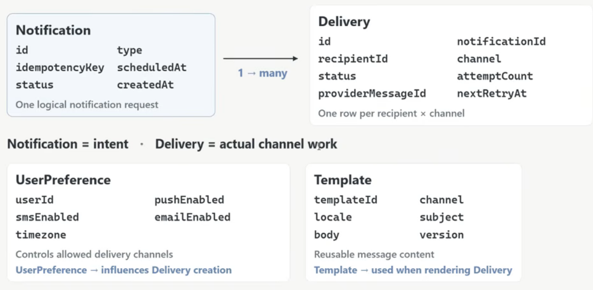

# Design Notification Services | System Design
- [Design a Scalable Notification System | Backend System Design by Sangam Mukherjee](https://www.youtube.com/watch?v=X6Iccw8DnDU)
- https://www.geeksforgeeks.org/system-design/design-notification-services-system-design/

## 1. REQUIREMENTS:
Core Capabilities:
## 1.1 Functional Requirements:
- support multiple delivery channels (`EMAIL`, `SMS`, `PUSH`, `IN_APP`)
- CRUD Notification templates
- Support `IMMEDIATE`/`SCHEDULED` notification delivery
- Track Delivery Status 
- RETRY Mechanism

---

## 1.2. Non-Functional Requirements:
- **Scalability**:  1M+ notifications / min
- **Reliability**: Accepted notifications must not disappear
- **CAP**: Availability >> Consistency  <== `Eventual consistency` is acceptable
- **Latency**: 
  - Real-time delivery for `HIGH_PRIORITY` notifications (`OTP`)
  - `5-10s` delay for **promotional** notifications
---

## 2. Back of Envelop Estimation (How much traffic are we design for?)
- 100M notifications / day 
- `~1.2K / sec` (Avg Ingest rate)
- `~12K / sec` (10 x Peak Ingest)
- `1-3` delivery channels per notification
- 1 logical notifications ==> 3 deliverable jobs (`PUSH`, `SMS`, `EMAIL`)

---

## 3. Components / Data Model / Core Entity
- User + Client (Flipkart, Amazon, etc...)
- UsePreference
  ```json
  {
    "userId": "1234",
    "clientId": "amz1",
    "preferences": {
      "email": false,
      "sms": true,
      "push": false,
    }
  }
  ```
- **Notification**: (id, type, client_id(`partition`), external_user_id, template_id, channel, payload, status, priority, ...metadata)
- **Template**: (id, name, type(`transactionsl`/`promotional`), channel, content/body, variables/data, version, is_active, created_at, updated_at, **locale** )
- **DeliveryStatus**: (`ACCEPTED/PENDING`, `SCHEDULED`, `SENT`, `DELIVERED / FAILED / CANCELLED`)
- **Priority**: HIGH (for OTP) / NORMAL / LOW (for PROMOTIONAL)

- > ACCEPTED --> QUEUED --> SENT --> DELIVERED/FAILED/CANCELLED




---

## 4. API Design
4.1. Create Notification
```shell
POST /notifications
{
    "type": "ORDER_PLACED",
    "recipientIds": ["u1", "u2", "u3"],
    "templateId": "order_placed-v1",
    "data": {"order_id": "ORD123", "amount": "200", } // template variables
    "channels?": ["PUSH", "SMS"],                     // optional
    "priority?": "HIGH",                              // optional
    "scheduledAt?": null,                             // optional
    "idempotencyKey": "evt_ai302_ord_b12-c7"
}
```

Immediate Response:
```json
{
  "notificationId": "Not1234",
  "status": "ACCEPTED",
  "acceptedAt": "2026-10-06T12:30:15Z"
}
```

4.2. Status lookup
```shell
POST /notifications/{notificationId}
{
  "notificationId": "Not1234",
  "type": "ORDER_PLACED",
  "status": "SENT",
  "channelStatuses": [
    "push": "DELIVERED",
    "sms": "SENT"
  ]
}
```
>ACCEPTED means: our platform successfully received the request <br>
> ACCEPTED --> QUEUED --> SENT --> DELIVERED/FAILED

---

## 5. High Level Design (HLD):


---

## 6. Low Level Design (LLD):