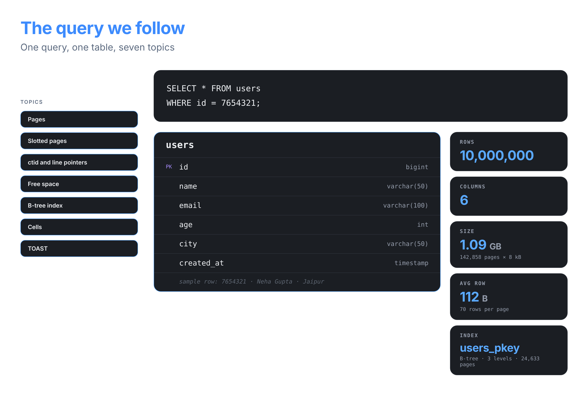
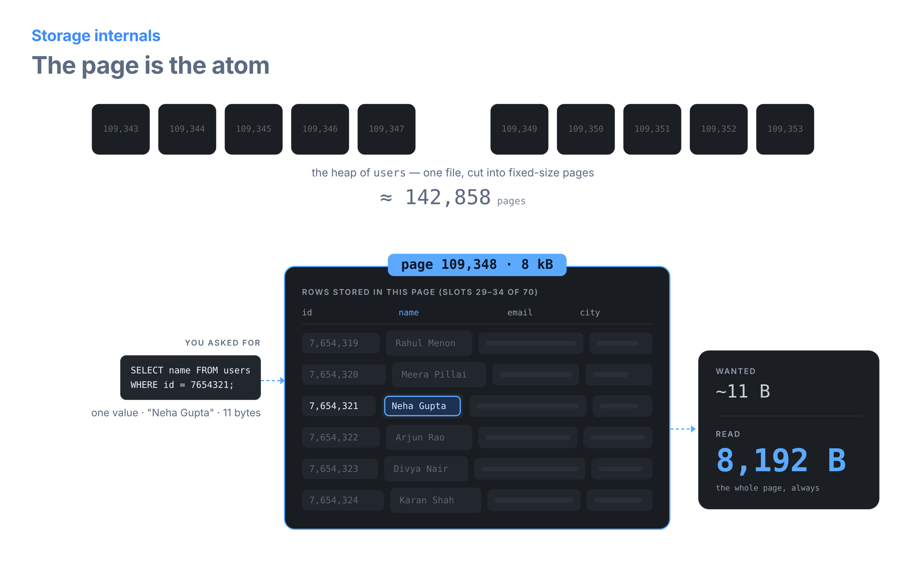
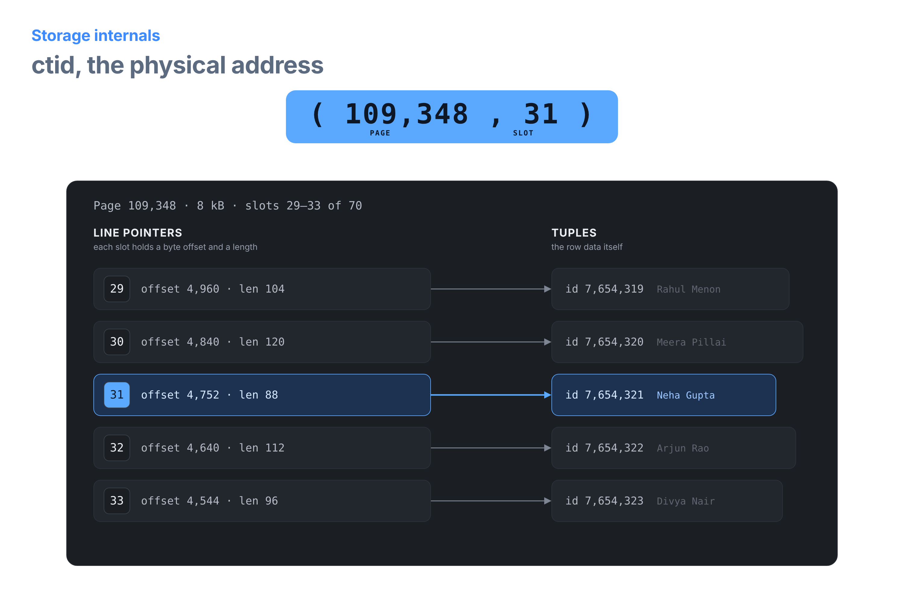
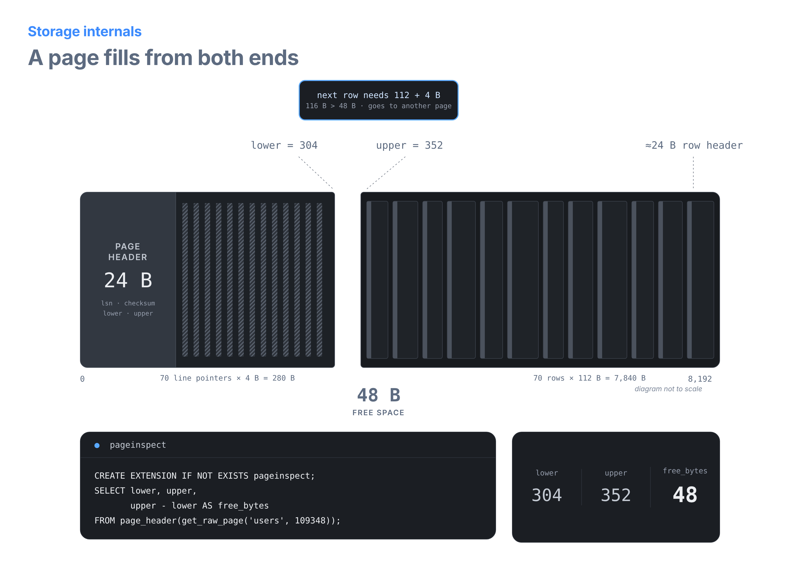
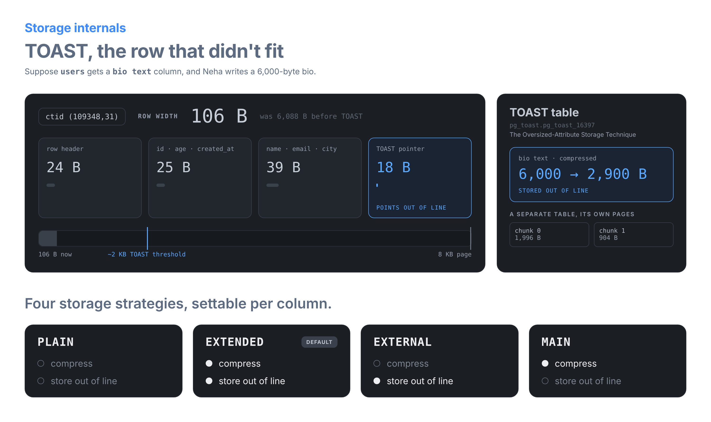

# Storage Internals, Visualised: The `users` Table

One query, one table, five pictures. Each image follows the same row through PostgreSQL's storage layer: `id = 7,654,321`, Neha Gupta, stored on heap page 109,348 in slot 31.

> The images are transparent PNGs, designed to read on both light and dark markdown themes. Keep them in the same folder as this file, or update the paths.

---

## 1. The query we follow



```sql
SELECT * FROM users WHERE id = 7654321;
```

| Fact | Value | How it was calculated |
|------|-------|-----------------------|
| Rows | 10,000,000 | Given |
| Average row | 112 B | 88 B of column data + 24 B row header |
| Rows per page | 70 | (8,192 − 24) ÷ (112 + 4) = 70.4 → 70 |
| Table size | 142,858 pages ≈ 1.09 GB | 10,000,000 ÷ 70, rounded up |
| Primary-key index | `users_pkey`, 3 levels, 24,633 pages | 407 entries per page: 24,571 leaves + 61 internal + 1 root |

---

## 2. The page is the atom



The table's heap is a single file cut into 8 kB pages. The database never reads less than a whole page.

To answer `SELECT name FROM users WHERE id = 7654321`, it needs one value, `"Neha Gupta"`, about 11 bytes. But that value lives on page 109,348, so the database reads all **8,192 bytes** of the page, including the other 69 rows.

This is why storage engines are designed around pages:

- **Read cost is counted in pages, not rows.** A query that touches 1 row on each of 1,000 pages costs 1,000 page reads.
- **Neighbouring rows are free.** Once page 109,348 is in memory, the other rows on it can be read without any more I/O.
- **Row size matters.** Wider rows mean fewer rows per page, so the same query reads more pages.

---

## 3. ctid, the physical address



Every row in PostgreSQL has a hidden column called `ctid`, its address as **(page number, slot number)**. Neha's row is at `(109348, 31)`.

Reading that address takes two steps:

1. **Page 109,348** → read 8 kB at byte offset 109,348 × 8,192 of the table's file.
2. **Slot 31** → look up line pointer 31 at the top of the page. It says the row starts at byte **4,752** and is **88 bytes** long.

The line pointers are in slot order, but each one holds its own offset and length, so rows of different sizes (104, 120, 88, 112, 96 bytes) can sit anywhere in the page.

You can see `ctid` directly:

```sql
SELECT ctid, id, name FROM users WHERE id = 7654321;
--     ctid      |   id    |    name
-- (109348,31)   | 7654321 | Neha Gupta
```

> `ctid` is a physical address. It changes when a row is updated (PostgreSQL writes a new version of the row) or when the table is rewritten, for example by `VACUUM FULL`. Never store it as a permanent ID.

The offsets in the image are illustrative: real values depend on the exact rows inserted.

---

## 4. A page fills from both ends



Inside page 109,348:

- The **page header** (24 B) sits at the start.
- **Line pointers** are added after it, growing **left to right**, 4 bytes each.
- **Tuples** (the rows) are added from the end of the page, growing **right to left**.
- The **free space** is whatever is left in the middle.

The header's `lower` and `upper` fields mark the two edges of the free space:

| Field | Meaning | Value | Calculation |
|-------|---------|-------|-------------|
| `lower` | End of the line pointers | 304 | 24 + 70 × 4 |
| `upper` | Start of the tuples | 352 | 8,192 − 70 × 112 |
| free | Gap between them | **48 B** | 352 − 304 |

A new row needs 112 bytes for itself plus 4 bytes for its line pointer, 116 bytes in total. Only 48 bytes are free, so PostgreSQL puts the new row on a different page.

You can check this on a real table with the `pageinspect` extension:

```sql
CREATE EXTENSION IF NOT EXISTS pageinspect;

SELECT lower, upper, upper - lower AS free_bytes
FROM page_header(get_raw_page('users', 109348));
```

---

## 5. TOAST, the row that didn't fit



Suppose `users` gets a `bio text` column, and Neha writes a 6,000-byte bio. Her row would grow from 88 bytes to about 6,088 bytes. That would use most of an 8 kB page for a single row.

PostgreSQL avoids this with **TOAST** (The Oversized-Attribute Storage Technique). When a row is larger than about **2 KB**, PostgreSQL shrinks it:

1. **Compress** large values first. Here the bio shrinks from 6,000 to about 2,900 bytes (the ratio depends on the text).
2. If the row is still too big, **move the value out of line** into a separate TOAST table that belongs to `users`. The value is cut into chunks of up to 1,996 bytes, so 2,900 bytes becomes two chunks of 1,996 and 904 bytes.
3. Leave an **18-byte TOAST pointer** in the row.

Neha's row ends up at 88 + 18 = **106 bytes**, so page 109,348 still holds about 70 rows. Queries that don't select `bio` never touch the TOAST table at all.

### Four storage strategies

Each column has a storage strategy that controls what TOAST may do with it:

| Strategy | Compress? | Store out of line? | Typical use |
|----------|-----------|--------------------|-------------|
| `PLAIN` | No | No | Fixed-size types such as `int` and `bigint` |
| `EXTENDED` | Yes | Yes | **Default** for most variable-size types (`text`, `jsonb`) |
| `EXTERNAL` | No | Yes | Large values that are read in pieces, such as `substring()` on long text |
| `MAIN` | Yes | Only as a last resort | Values you want kept in the row when possible |

```sql
ALTER TABLE users ALTER COLUMN bio SET STORAGE EXTERNAL;
```

---

## Summary

| Image | Key idea |
|-------|----------|
| 1. The query we follow | A 10-million-row table is 142,858 pages of 8 kB |
| 2. The page is the atom | Reading one value always means reading its whole page |
| 3. ctid | A row's address is (page, slot); the slot holds its offset and length |
| 4. Page fills from both ends | Line pointers grow right, tuples grow left, free space is `upper − lower` |
| 5. TOAST | Large values are compressed or moved out of line, leaving an 18-byte pointer |
